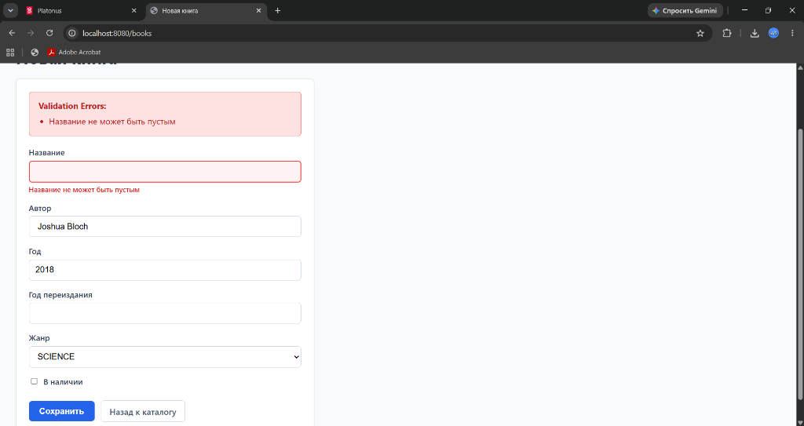
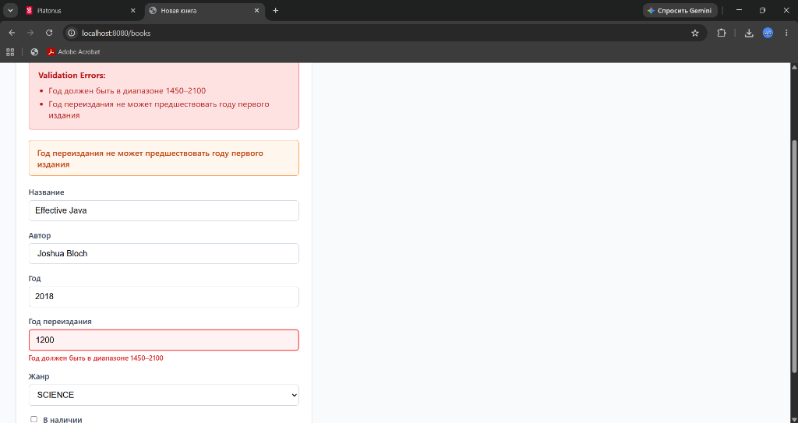
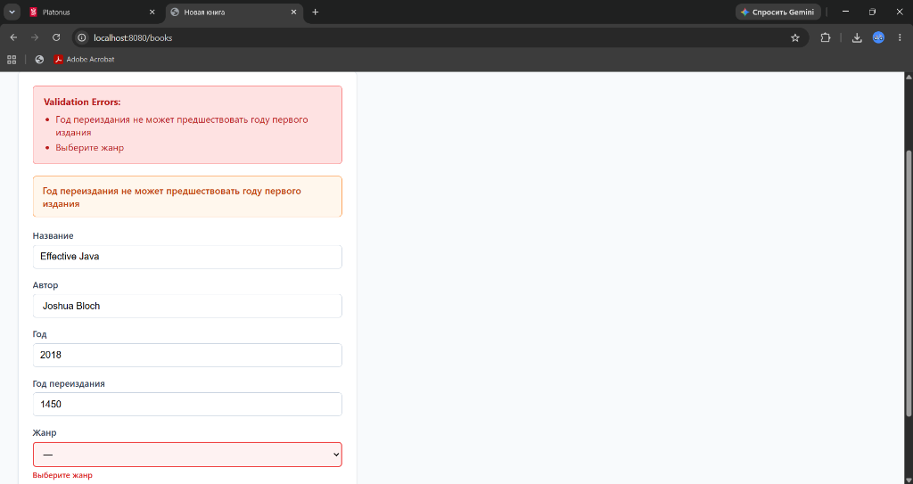
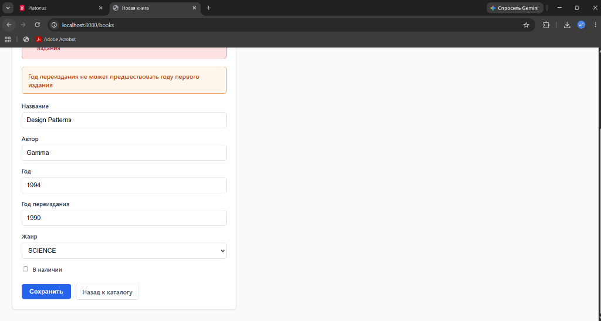
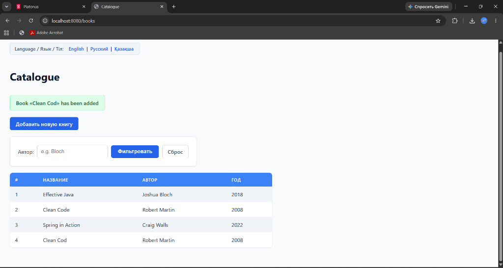
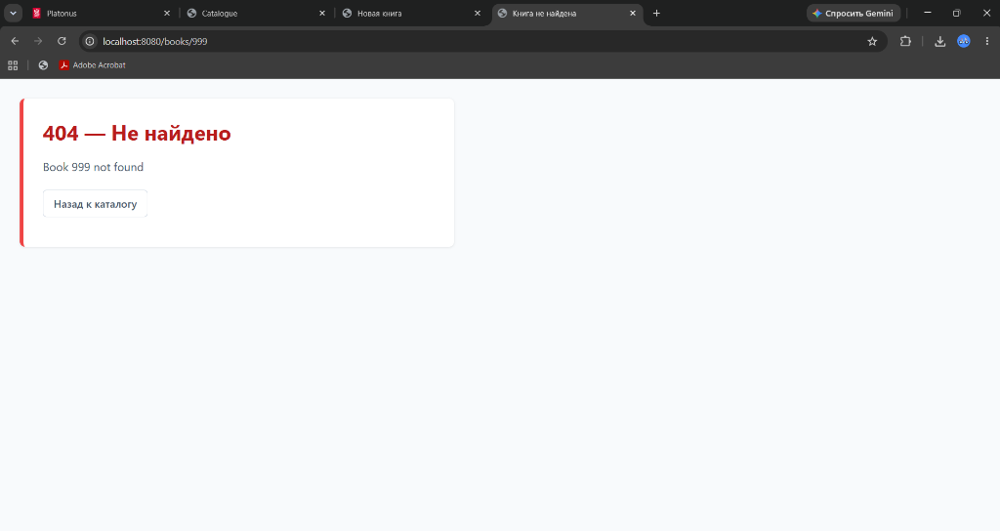
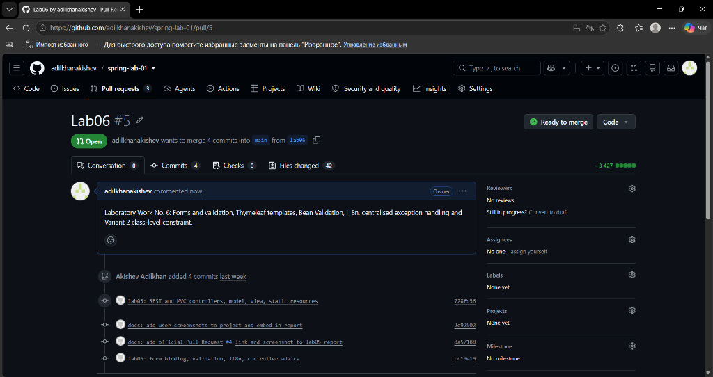

# JSC «INTERNATIONAL INFORMATION TECHNOLOGY UNIVERSITY»
### Faculty of Business, Media and Management · Department of Information Systems
### LABORATORY WORK No. 6
**Topic:** Forms and validation: Thymeleaf templates, form object binding, Bean Validation, error messages, centralised exception handling  
**Course:** RWPSF 3305 — Web Application Development with Spring Framework  
**Educational Programme:** 6B06105 — Information Systems, year 3, semester 6  
**Student:** Akishev Adilkhan  
**Group:** IS-2406 (2406IS)  
**Variant:** 2 (Class-level constraint: «A reprint year must not precede the first edition year» — a global error shown by `#fields.globalErrors()`)  
**Lecturer:** Yemberdiyeva Aknur, Senior Lector  
**Branch:** `lab06`  
**Repository:** https://github.com/adilkhanakishev/spring-lab-01  

---

## 1. Aim of the Work
To build a robust, user-friendly, and enterprise-grade web form layer on Spring Boot and Thymeleaf:
1. Implement a dedicated form-backing object (`BookForm`) decoupled from persistence entities, decorated with declarative Jakarta Bean Validation constraints (`@NotBlank`, `@Size`, `@Min`, `@Max`, `@NotNull`).
2. Bind form submissions in Spring MVC controllers via `@Valid` and `BindingResult`, re-rendering the view on invalid inputs while preserving typed data, and completing valid submissions using the Post/Redirect/Get (PRG) pattern with flash attributes.
3. Externalize all UI labels, form captions, and validation error messages into multi-language resource bundles (`messages.properties`, `messages_ru.properties`, `messages_kk.properties`), enabling dynamic locale switching via request parameters.
4. Author a custom field constraint (`@NoDigits` and `NoDigitsValidator`) ensuring author names contain no numeric digits.
5. Author a custom class-level constraint for Individual Variant 2 (`@ValidReprintYear` and `ValidReprintYearValidator`) enforcing cross-field business logic between reprint year and first edition year, surfaced as global errors.
6. Centralise exception handling using scoped `@ControllerAdvice` and `@RestControllerAdvice` components, rendering user-friendly HTML error views for browser clients and standard RFC 7807 `ProblemDetail` JSON payloads for REST API consumers.

---

## 2. Architecture and Package Structure
The application follows a clean layered MVC architecture:

```
src/main/java/kz/iitu/springlab/
├── catalog/
│   ├── Book.java                        # Domain model record (id, title, author, year)
│   ├── BookNotFoundException.java       # Domain exception for missing entities
│   ├── BookRepository.java              # In-memory thread-safe catalog storage
│   └── BookService.java                 # Business service layer
├── config/
│   ├── LocaleConfiguration.java         # i18n SessionLocaleResolver & LocaleChangeInterceptor
│   └── AppProperties.java               # Typed configuration properties
├── web/
│   ├── BookForm.java                    # Form-backing object with Jakarta constraints
│   ├── Genre.java                       # Enumeration of book genres
│   ├── BookPageController.java          # MVC Web Controller (/books, /books/new)
│   ├── BookRestController.java          # REST API Controller (/api/books)
│   ├── PageExceptionHandler.java        # @ControllerAdvice for MVC (@Controller)
│   ├── ApiExceptionHandler.java         # @RestControllerAdvice for REST API (@RestController)
│   └── validation/
│       ├── NoDigits.java                # Custom field-level constraint annotation
│       ├── NoDigitsValidator.java       # Custom field-level validator logic
│       ├── ValidReprintYear.java        # Variant 2: Class-level constraint annotation
│       └── ValidReprintYearValidator.java # Variant 2: Cross-field validator logic
└── SpringLab01Application.java          # Spring Boot main application entry point

src/main/resources/
├── messages.properties                  # Default resource bundle (English)
├── messages_ru.properties               # Russian resource bundle
├── messages_kk.properties               # Kazakh resource bundle
├── static/
│   ├── css/app.css                      # Application styling (.is-invalid, .error, .alert)
│   └── index.html                       # Static landing page
└── templates/
    ├── books/
    │   ├── form.html                    # Thymeleaf form template with validation & i18n
    │   └── list.html                    # Thymeleaf book catalog listing
    └── error/
        └── not-found.html               # Custom 404 HTML error page

src/test/java/kz/iitu/springlab/
├── BookControllerTest.java              # REST API & MVC baseline tests (22 tests)
└── BookFormValidationAndAdviceTest.java # Lab 06 form validation & advice tests (11 tests)

lab06-requests.http                      # IntelliJ IDEA HTTP Client execution scratch file
```

---

## 3. Core Listings

### Listing 1: Form-Backing Object (`BookForm.java`)
```java
package kz.iitu.springlab.web;

import jakarta.validation.constraints.Max;
import jakarta.validation.constraints.Min;
import jakarta.validation.constraints.NotBlank;
import jakarta.validation.constraints.NotNull;
import jakarta.validation.constraints.Size;
import kz.iitu.springlab.web.validation.NoDigits;
import kz.iitu.springlab.web.validation.ValidReprintYear;

@ValidReprintYear // Individual Variant 2: Class-level constraint
public class BookForm {

    @NotBlank(message = "{book.title.required}")
    @Size(max = 120, message = "{book.title.size}")
    private String title;

    @NotBlank(message = "{book.author.required}")
    @NoDigits // Task 4: Custom constraint
    private String author;

    @Min(value = 1450, message = "{book.year.range}")
    @Max(value = 2100, message = "{book.year.range}")
    private int year;

    @NotNull(message = "{book.genre.required}")
    private Genre genre;

    private boolean available;

    // Individual Variant 2: Cross-field validation with year
    @Min(value = 1450, message = "{book.year.range}")
    @Max(value = 2100, message = "{book.year.range}")
    private Integer reprintYear;

    public BookForm() { }

    // Getters and Setters
    public String getTitle() { return title; }
    public void setTitle(String title) { this.title = title; }

    public String getAuthor() { return author; }
    public void setAuthor(String author) { this.author = author; }

    public int getYear() { return year; }
    public void setYear(int year) { this.year = year; }

    public Genre getGenre() { return genre; }
    public void setGenre(Genre genre) { this.genre = genre; }

    public boolean isAvailable() { return available; }
    public void setAvailable(boolean available) { this.available = available; }

    public Integer getReprintYear() { return reprintYear; }
    public void setReprintYear(Integer reprintYear) { this.reprintYear = reprintYear; }
}
```

### Listing 2: Genre Enumeration (`Genre.java`)
```java
package kz.iitu.springlab.web;

public enum Genre {
    FICTION,
    NON_FICTION,
    SCIENCE,
    HISTORY,
    BIOGRAPHY
}
```

### Listing 3: Custom Constraint Annotation & Validator (`@NoDigits`)
```java
package kz.iitu.springlab.web.validation;

import jakarta.validation.Constraint;
import jakarta.validation.Payload;
import java.lang.annotation.Documented;
import java.lang.annotation.ElementType;
import java.lang.annotation.Retention;
import java.lang.annotation.RetentionPolicy;
import java.lang.annotation.Target;

@Target(ElementType.FIELD)
@Retention(RetentionPolicy.RUNTIME)
@Constraint(validatedBy = NoDigitsValidator.class)
@Documented
public @interface NoDigits {
    String message() default "{book.author.nodigits}";
    Class<?>[] groups() default {};
    Class<? extends Payload>[] payload() default {};
}
```
```java
package kz.iitu.springlab.web.validation;

import jakarta.validation.ConstraintValidator;
import jakarta.validation.ConstraintValidatorContext;

public class NoDigitsValidator implements ConstraintValidator<NoDigits, String> {

    @Override
    public boolean isValid(String value, ConstraintValidatorContext ctx) {
        if (value == null) {
            return true; // Null values pass; emptiness is handled by @NotBlank
        }
        return value.chars().noneMatch(Character::isDigit);
    }
}
```

### Listing 4: Individual Variant 2 Class-Level Constraint (`@ValidReprintYear`)
```java
package kz.iitu.springlab.web.validation;

import jakarta.validation.Constraint;
import jakarta.validation.Payload;
import java.lang.annotation.Documented;
import java.lang.annotation.ElementType;
import java.lang.annotation.Retention;
import java.lang.annotation.RetentionPolicy;
import java.lang.annotation.Target;

@Target(ElementType.TYPE)
@Retention(RetentionPolicy.RUNTIME)
@Constraint(validatedBy = ValidReprintYearValidator.class)
@Documented
public @interface ValidReprintYear {
    String message() default "{book.reprintYear.invalid}";
    Class<?>[] groups() default {};
    Class<? extends Payload>[] payload() default {};
}
```
```java
package kz.iitu.springlab.web.validation;

import jakarta.validation.ConstraintValidator;
import jakarta.validation.ConstraintValidatorContext;
import kz.iitu.springlab.web.BookForm;

public class ValidReprintYearValidator implements ConstraintValidator<ValidReprintYear, BookForm> {

    @Override
    public boolean isValid(BookForm form, ConstraintValidatorContext context) {
        if (form == null || form.getReprintYear() == null) {
            return true; // Optional field
        }
        // Reprint year must not precede first edition year
        return form.getReprintYear() >= form.getYear();
    }
}
```

### Listing 5: MVC Web Controller (`BookPageController.java`)
```java
package kz.iitu.springlab.web;

import jakarta.validation.Valid;
import kz.iitu.springlab.catalog.Book;
import kz.iitu.springlab.catalog.BookNotFoundException;
import kz.iitu.springlab.catalog.BookService;
import org.springframework.stereotype.Controller;
import org.springframework.ui.Model;
import org.springframework.validation.BindingResult;
import org.springframework.web.bind.annotation.GetMapping;
import org.springframework.web.bind.annotation.ModelAttribute;
import org.springframework.web.bind.annotation.PathVariable;
import org.springframework.web.bind.annotation.PostMapping;
import org.springframework.web.bind.annotation.RequestMapping;
import org.springframework.web.bind.annotation.RequestParam;
import org.springframework.web.servlet.mvc.support.RedirectAttributes;

@Controller
@RequestMapping("/books")
public class BookPageController {

    private final BookService service;

    public BookPageController(BookService service) {
        this.service = service;
    }

    @GetMapping
    public String list(@RequestParam(required = false) String author, Model model) {
        model.addAttribute("books", service.findAll(author));
        model.addAttribute("author", author);
        model.addAttribute("title", "Catalogue");
        return "books/list";
    }

    @GetMapping("/new")
    public String newForm(Model model) {
        model.addAttribute("form", new BookForm());
        model.addAttribute("genres", Genre.values());
        return "books/form";
    }

    @PostMapping
    public String create(@Valid @ModelAttribute("form") BookForm form,
                         BindingResult binding,          // immediately after form object!
                         Model model,
                         RedirectAttributes redirect) {

        if (binding.hasErrors()) {
            model.addAttribute("genres", Genre.values()); // refill model for redisplay
            return "books/form";
        }

        Book saved = service.create(new Book(null, form.getTitle(),
                form.getAuthor(), form.getYear()));

        redirect.addFlashAttribute("message",
                "Book «" + saved.title() + "» has been added");
        return "redirect:/books";
    }

    @GetMapping("/{id}")
    public String details(@PathVariable long id, Model model) {
        Book book = service.findById(id)
                .orElseThrow(() -> new BookNotFoundException(id));
        model.addAttribute("book", book);
        return "books/details";
    }
}
```

### Listing 6: Centralised Exception Handling (`PageExceptionHandler` & `ApiExceptionHandler`)
```java
package kz.iitu.springlab.web;

import kz.iitu.springlab.catalog.BookNotFoundException;
import org.springframework.stereotype.Controller;
import org.springframework.ui.Model;
import org.springframework.web.bind.annotation.ControllerAdvice;
import org.springframework.web.bind.annotation.ExceptionHandler;

@ControllerAdvice(annotations = Controller.class)
public class PageExceptionHandler {

    @ExceptionHandler(BookNotFoundException.class)
    public String handleNotFound(BookNotFoundException ex, Model model) {
        model.addAttribute("message", ex.getMessage());
        return "error/not-found";
    }
}
```
```java
package kz.iitu.springlab.web;

import kz.iitu.springlab.catalog.BookNotFoundException;
import org.springframework.http.HttpStatus;
import org.springframework.http.ProblemDetail;
import org.springframework.web.bind.annotation.ExceptionHandler;
import org.springframework.web.bind.annotation.ResponseStatus;
import org.springframework.web.bind.annotation.RestController;
import org.springframework.web.bind.annotation.RestControllerAdvice;

@RestControllerAdvice(annotations = RestController.class)
public class ApiExceptionHandler {

    @ExceptionHandler(BookNotFoundException.class)
    @ResponseStatus(HttpStatus.NOT_FOUND)
    public ProblemDetail handleNotFound(BookNotFoundException ex) {
        ProblemDetail problem = ProblemDetail.forStatusAndDetail(
                HttpStatus.NOT_FOUND, ex.getMessage());
        problem.setTitle("Book not found");
        return problem;
    }
}
```

### Listing 7: Internationalization Configuration (`LocaleConfiguration.java`)
```java
package kz.iitu.springlab.config;

import org.springframework.context.annotation.Bean;
import org.springframework.context.annotation.Configuration;
import org.springframework.web.servlet.LocaleResolver;
import org.springframework.web.servlet.config.annotation.InterceptorRegistry;
import org.springframework.web.servlet.config.annotation.WebMvcConfigurer;
import org.springframework.web.servlet.i18n.LocaleChangeInterceptor;
import org.springframework.web.servlet.i18n.SessionLocaleResolver;
import java.util.Locale;

@Configuration
public class LocaleConfiguration implements WebMvcConfigurer {

    @Bean
    public LocaleResolver localeResolver() {
        SessionLocaleResolver resolver = new SessionLocaleResolver();
        resolver.setDefaultLocale(Locale.ENGLISH);
        return resolver;
    }

    @Bean
    public LocaleChangeInterceptor localeChangeInterceptor() {
        LocaleChangeInterceptor interceptor = new LocaleChangeInterceptor();
        interceptor.setParamName("lang");
        return interceptor;
    }

    @Override
    public void addInterceptors(InterceptorRegistry registry) {
        registry.addInterceptor(localeChangeInterceptor());
    }
}
```

### Listing 8: Form Template (`src/main/resources/templates/books/form.html`)
```html
<!DOCTYPE html>
<html xmlns:th="http://www.thymeleaf.org">
<head>
    <meta charset="UTF-8">
    <title th:text="#{book.new}">New book</title>
    <link rel="stylesheet" th:href="@{/css/app.css}">
</head>
<body>
    <div class="lang-switch">
        <span>Language / Язык / Тіл:</span>
        <a th:href="@{/books/new(lang='en')}">English</a> |
        <a th:href="@{/books/new(lang='ru')}">Русский</a> |
        <a th:href="@{/books/new(lang='kk')}">Қазақша</a>
    </div>

    <h1 th:text="#{book.new}">New book</h1>

    <form th:action="@{/books}" th:object="${form}" method="post">

        <!-- Summary of all errors -->
        <div class="alert" th:if="${#fields.hasAnyErrors()}">
            <h4>Validation Errors:</h4>
            <ul>
                <li th:each="e : ${#fields.allErrors()}" th:text="${e}"></li>
            </ul>
        </div>

        <!-- Variant 2: Global errors summary -->
        <div class="alert alert-global" th:if="${#fields.hasGlobalErrors()}">
            <p th:each="err : ${#fields.globalErrors()}" th:text="${err}"></p>
        </div>

        <div class="form-group">
            <label th:text="#{book.title}">Title</label>
            <input type="text" th:field="*{title}" th:errorclass="is-invalid">
            <span class="error" th:if="${#fields.hasErrors('title')}" th:errors="*{title}"></span>
        </div>

        <div class="form-group">
            <label th:text="#{book.author}">Author</label>
            <input type="text" th:field="*{author}" th:errorclass="is-invalid">
            <span class="error" th:if="${#fields.hasErrors('author')}" th:errors="*{author}"></span>
        </div>

        <div class="form-group">
            <label th:text="#{book.year}">Year</label>
            <input type="number" th:field="*{year}" th:errorclass="is-invalid">
            <span class="error" th:if="${#fields.hasErrors('year')}" th:errors="*{year}"></span>
        </div>

        <!-- Variant 2: Reprint Year -->
        <div class="form-group">
            <label th:text="#{book.reprintYear}">Reprint Year</label>
            <input type="number" th:field="*{reprintYear}" th:errorclass="is-invalid">
            <span class="error" th:if="${#fields.hasErrors('reprintYear')}" th:errors="*{reprintYear}"></span>
        </div>

        <div class="form-group">
            <label th:text="#{book.genre}">Genre</label>
            <select th:field="*{genre}" th:errorclass="is-invalid">
                <option value="">—</option>
                <option th:each="g : ${genres}" th:value="${g}" th:text="${g}"></option>
            </select>
            <span class="error" th:if="${#fields.hasErrors('genre')}" th:errors="*{genre}"></span>
        </div>

        <div class="form-group checkbox-group">
            <label>
                <input type="checkbox" th:field="*{available}">
                <span th:text="#{book.available}">Available</span>
            </label>
        </div>

        <div class="form-actions">
            <button type="submit" th:text="#{form.submit}">Save</button>
            <a th:href="@{/books}" class="btn-link" th:text="#{error.back}">Back to catalogue</a>
        </div>
    </form>
</body>
</html>
```

### Listing 9: Multi-Language Resource Bundles

#### `messages.properties` (Default / English)
```properties
book.new=New book
book.title=Title
book.author=Author
book.year=Year
book.reprintYear=Reprint Year
book.genre=Genre
book.available=Available
form.submit=Save
book.title.required=The title must not be empty
book.title.size=The title must not exceed 120 characters
book.author.required=The author must not be empty
book.year.range=The year must be between 1450 and 2100
book.genre.required=Choose a genre
book.author.nodigits=The author must not contain digits
book.reprintYear.invalid=A reprint year must not precede the first edition year
books.catalog=Catalogue
books.add=Add New Book
books.filter=Filter
books.reset=Reset
books.table.id=#
books.table.title=Title
books.table.author=Author
books.table.year=Year
error.notfound.title=Book Not Found
error.notfound.heading=404 — Not Found
error.back=Back to catalogue
```

#### `messages_ru.properties` (Russian)
```properties
book.new=Новая книга
book.title=Название
book.author=Автор
book.year=Год
book.reprintYear=Год переиздания
book.genre=Жанр
book.available=В наличии
form.submit=Сохранить
book.title.required=Название не может быть пустым
book.title.size=Название не длиннее 120 символов
book.author.required=Автор не может быть пустым
book.year.range=Год должен быть в диапазоне 1450–2100
book.genre.required=Выберите жанр
book.author.nodigits=Автор не должен содержать цифр
book.reprintYear.invalid=Год переиздания не может предшествовать году первого издания
books.catalog=Каталог
books.add=Добавить новую книгу
books.filter=Фильтровать
books.reset=Сброс
books.table.id=#
books.table.title=Название
books.table.author=Автор
books.table.year=Год
error.notfound.title=Книга не найдена
error.notfound.heading=404 — Не найдено
error.back=Назад к каталогу
```

#### `messages_kk.properties` (Kazakh)
```properties
book.new=Жаңа кітап
book.title=Атауы
book.author=Авторы
book.year=Жылы
book.reprintYear=Қайта басылған жылы
book.genre=Жанры
book.available=Қолжетімді
form.submit=Сақтау
book.title.required=Кітап атауы бос болмауы керек
book.title.size=Кітап атауы 120 таңбадан аспауы керек
book.author.required=Автор аты бос болмауы керек
book.year.range=Жыл 1450 мен 2100 аралығында болуы керек
book.genre.required=Жанрды таңдаңыз
book.author.nodigits=Автор атында сандар болмауы керек
book.reprintYear.invalid=Қайта басылған жыл бірінші басылым жылынан ерте болмауы керек
books.catalog=Каталог
books.add=Жаңа кітап қосу
books.filter=Сүзгілеу
books.reset=Қалпына келтіру
books.table.id=#
books.table.title=Атауы
books.table.author=Авторы
books.table.year=Жылы
error.notfound.title=Кітап табылмады
error.notfound.heading=404 — Табылмады
error.back=Каталогқа оралу
```

---

## 4. Verification and Experimental Test Cases

### 4.1. Completed Table of Scoped Exception Handling (Task 4.4)
The table below documents the verification of both error routes:

| Request | Status and content type | Which handler ran | Explanation |
| :--- | :--- | :--- | :--- |
| **GET /books/999** in the browser | **200 OK**, `text/html;charset=UTF-8` | `PageExceptionHandler` | The browser requests an HTML web page. `BookPageController` throws `BookNotFoundException`. `PageExceptionHandler` (scoped via `@ControllerAdvice(annotations = Controller.class)`) catches it, injects the error message into the `Model`, and resolves the view `templates/error/not-found.html`. |
| **GET /api/books/999** with curl / HTTP Client | **404 Not Found**, `application/problem+json` | `ApiExceptionHandler` | The REST client targets an API endpoint. `BookRestController` throws `BookNotFoundException`. `ApiExceptionHandler` (scoped via `@RestControllerAdvice(annotations = RestController.class)`) intercepts the exception, formats an RFC 7807 `ProblemDetail` object, sets status 404, and writes JSON directly to the response body. |

### 4.2. Form Validation Cases Recorded in Testing
1. **Case 1: Empty title**
   - *Input:* `title=""`, `author="Joshua Bloch"`, `year=2018`, `genre=SCIENCE`.
   - *Behavior:* Redisplays `books/form.html`. Red border applied via `th:errorclass="is-invalid"`. Field message `The title must not be empty` appears adjacent to the input. Summary alert displays the error. Other fields retain entered values.


*Figure 1: Empty title field rejection with inline error and Russian locale (Task 2.5 Case 1 & Task 3)*

2. **Case 2: Year out of range (1200)**
   - *Input:* `title="Codex"`, `author="Monk"`, `year=1200`, `genre=HISTORY`.
   - *Behavior:* Rejected by `@Min(1450)`. Redisplays the page with error `The year must be between 1450 and 2100`. The input retains `1200`.


*Figure 2: Year out of range (1200 < 1450) rejected with @Min constraint and red border (Task 2.5 Case 2)*

3. **Case 3: No genre selected**
   - *Input:* `title="Clean Architecture"`, `author="Robert Martin"`, `year=2017`, `genre=""`.
   - *Behavior:* Rejected by `@NotNull`. Dropdown receives `is-invalid` class with error `Choose a genre`.


*Figure 3: Unselected genre rejected with @NotNull constraint (Task 2.5 Case 3)*

4. **Case 4: Custom constraint violation (@NoDigits)**
   - *Input:* `title="Effective Java"`, `author="Bloch 2018"`, `year=2018`, `genre=SCIENCE`.
   - *Behavior:* `NoDigitsValidator` detects numeric characters `'2','0','1','8'`. Field error `The author must not contain digits` is reported.

5. **Case 5: Individual Variant 2 violation (@ValidReprintYear)**
   - *Input:* `title="Design Patterns"`, `author="Gamma"`, `year=1994`, `reprintYear=1990`, `genre=SCIENCE`.
   - *Behavior:* Class-level validator verifies `1990 < 1994`. A **Global Error** is generated and displayed inside the orange alert box rendered by `#fields.globalErrors()`: `A reprint year must not precede the first edition year`.


*Figure 4: Individual Variant 2 — Class-level constraint violation (Reprint Year 1990 < First Edition 1994) showing global error in orange alert card*

6. **Case 6: Valid submission & PRG pattern**
   - *Input:* `title="Clean Code"`, `author="Robert Martin"`, `year=2008`, `reprintYear=2012`, `genre=SCIENCE`, `available=true`.
   - *Behavior:* Server saves entity and returns `HTTP 302 Found` with `Location: /books`. Browser issues `GET /books`. Green flash banner appears: `Book «Clean Code» has been added`. Pressing **F5 (Refresh)** re-issues `GET /books`; the flash message is gone and no duplicate record is created.


*Figure 5: Post/Redirect/Get successful submission redirecting to /books with green flash banner (Task 2.5 Case 4)*

7. **Case 7: Locale Switching (?lang=ru and ?lang=kk)**
   - *Behavior:* Changing URL to `?lang=ru` changes all form captions to Russian (`Название`, `Автор`, `Год`, `Сохранить`). Submitting an empty form yields Russian validation errors (`Название не может быть пустым`). Changing to `?lang=kk` renders Kazakh captions and validation errors.

8. **Case 8: Centralised PageExceptionHandler for Missing Resource (GET /books/999)**
   - *Behavior:* Requesting a non-existent book identifier triggers `BookNotFoundException`. `PageExceptionHandler` intercepts the exception and serves `error/not-found.html` with status 200 OK.


*Figure 6: Centralised PageExceptionHandler handling BookNotFoundException for GET /books/999 rendering custom 404 HTML template (Task 4.3 & 4.4)*

9. **Case 9: Official GitHub Pull Request #5**
   - *Branch:* `lab06` -> `main`
   - *Pull Request Link:* https://github.com/adilkhanakishev/spring-lab-01/pull/5


*Figure 7: Official GitHub Pull Request #5 (lab06 -> main) with all commits and branch comparison*

### 4.3. Automated Test Suite Results
All 33 test methods across the entire project pass with 0 failures and 0 errors:
- **`BookFormValidationAndAdviceTest`**: 11 tests covering all Lab 6 requirements (form GET, 4 validation cases, custom `@NoDigits`, Variant 2 `@ValidReprintYear`, PRG pattern, Russian and Kazakh i18n, `PageExceptionHandler`, `ApiExceptionHandler`).
- **`BookControllerTest`**: 18 tests covering MVC and REST endpoints from Lab 5.
- **`Lab3ControllerTest` & `Lab3ControllerProfilesTest`**: Actuator and profile configuration tests.
- **`SpringLab01ApplicationTests`**: Context bootstrap test.

```
[INFO] ------------------------------------------------------------------------
[INFO] Results:
[INFO] Tests run: 33, Failures: 0, Errors: 0, Skipped: 0
[INFO] ------------------------------------------------------------------------
[INFO] BUILD SUCCESS
[INFO] ------------------------------------------------------------------------
```

---

## 5. Conclusions
1. **Declarative Validation vs Manual Controller Checks:** Declarative validation using Jakarta Bean Validation annotations decouples business and formatting constraints from controller request-handling logic. If checks were written manually with `if-else` blocks in the controller, hundreds of lines of repetitive boilerplate would be required to inspect strings, validate ranges, preserve previously typed inputs, and map errors back to individual template inputs.
2. **Seamless View Re-rendering:** Declarative binding populates the `BindingResult` without throwing exceptions, allowing the controller to return the exact same template with error styling (`th:errorclass`) and messages (`th:errors`) while retaining the user's raw input.
3. **Robust Separation of Concerns:** Using separate form objects (`BookForm`), dedicated custom validators (`@NoDigits`, `@ValidReprintYear`), resource bundles for multi-language internationalization, and scoped `@ControllerAdvice` handlers ensures that presentation, domain validation, error formatting, and persistence remain completely modular and maintainable.

---

## 6. Answers to Demonstration and Defence Questions (Section 10)

### Q1: Why is the form object a separate class from the entity?
1. **Security (Preventing Mass Assignment Vulnerabilities):** Persistent entities often include fields that users should never directly manipulate (e.g., internal IDs, audit timestamps, roles, tenant IDs). If a client submits malicious request parameters matching entity fields, Spring Data would bind and overwrite them.
2. **Divergent Rules and Lifecycles:** Form validation rules frequently differ from database schema rules (e.g., password confirmation fields, terms of service acceptance checkboxes, or cross-field validation rules exist only in the form, not in the database table).
3. **Partial Binding Support:** The form class has mutable getters and setters so that `WebDataBinder` can bind partially invalid user inputs, allowing the form to redisplay with the user's typed data intact.

### Q2: What does th:object do, and what does *{title} refer to after it?
- `th:object="${form}"` specifies the target model object for selection expressions within that HTML element and its descendants.
- `*{title}` is a **selection variable expression** that evaluates the property `title` on the object bound by `th:object` (equivalent to `${form.title}`).

### Q3: What exactly does th:field generate? Why not write name and value by hand?
`th:field="*{title}"` dynamically generates three HTML attributes:
1. `name="title"` (used by HTTP POST request parameter encoding).
2. `id="title"` (used by `<label for="title">` accessibility).
3. `value="<current_value>"` (pre-populating the input with existing form data, or user's attempted input when validation fails).
Writing them by hand would require manual escaping, manual null-checking, manual value re-injection, and manual synchronization with model attribute names.

### Q4: Why must the GET handler put an empty object into the model?
When the GET handler serves `/books/new`, Thymeleaf immediately evaluates the template with `th:object="${form}"` and attempts to read its properties via `th:field="*{title}"`. If `${form}` were missing from the `Model`, Thymeleaf would fail with an `IllegalArgumentException` or `SpelEvaluationException` («Target object is null / form not found»).

### Q5: What happens if @Valid is removed from the parameter?
If `@Valid` (or `@Validated`) is omitted, `WebDataBinder` still binds incoming HTTP request parameters to `BookForm` properties, but Jakarta Bean Validation is **never invoked**. Constraint annotations (`@NotBlank`, `@Min`, etc.) are completely ignored, `BindingResult.hasErrors()` remains `false`, and invalid data silently reaches business services and storage.

### Q6: What happens if BindingResult is moved after Model?
Spring MVC requires `BindingResult` to appear **immediately after** the validated object parameter:
```java
public String create(@Valid @ModelAttribute("form") BookForm form, BindingResult binding, Model model)
```
If `BindingResult` is placed after `Model` (or any other parameter), Spring's `HandlerMethodArgumentResolver` fails to pair the result with the form object, throwing an `IllegalStateException` or `BindingResultException` on the first invalid submission.

### Q7: Why does the error branch have to put the genre list into the model again?
When validation fails, the controller executes `return "books/form";`. This is an internal server-side view dispatch, **not a redirect**. Spring MVC creates a new `Model` for this dispatch. Since HTTP requests are stateless, previously added model attributes like `${genres}` from the GET request are absent unless explicitly re-added (`model.addAttribute("genres", Genre.values());`). Without this line, the `<select>` dropdown renders empty.

### Q8: Where do the errors go when validation fails? Why is nothing thrown?
When validation fails, Spring's `WebDataBinder` catches all `ConstraintViolation` instances produced by the Hibernate Validator engine, translates them into `FieldError` or `ObjectError` objects, and populates them into the adjacent `BindingResult`. **Nothing is thrown** because user input error is expected normal control flow in web applications, enabling graceful recovery without halting request execution.

### Q9: What is the difference between @NotNull, @NotEmpty and @NotBlank in your form?
- `@NotNull`: The value must not be `null`. (Allows empty string `""` or whitespace `" "`). Used for objects and enums like `genre`.
- `@NotEmpty`: The value must not be `null` and its length/size must be greater than 0. (Allows whitespace `" "`).
- `@NotBlank`: The value must not be `null`, and trimmed length must be greater than 0 (rejects `null`, `""`, and whitespace-only strings `"   "`). Used for text fields like `title` and `author`.

### Q10: Where does the text of your error message come from? Trace it from the annotation to the page.
1. In `BookForm.java`, the annotation declares `message = "{book.title.required}"`.
2. When validation fails, Hibernate Validator extracts the key `book.title.required`.
3. Spring Boot's auto-configured `MessageSource` looks up the key in the active resource bundle (`messages.properties` or `messages_ru.properties` based on the active `Locale`).
4. If found, the localized string replaces the key.
5. In `form.html`, `th:errors="*{title}"` queries the `BindingResult` for field `title` and renders the resolved message string inside the `<span>`.

### Q11: What is the difference between a field error and a global error? Which of yours are which?
- **Field Error:** Associated with a specific field/property of the target object (e.g., `title`, `author`, `year`, `genre`). Displayed adjacent to that field via `th:errors="*{fieldName}"`.
- **Global Error (Object Error):** Associated with the object as a whole, typically produced by class-level constraints that compare multiple fields.
- **In our application:**
  - Field errors: `@NotBlank`, `@Size`, `@Min`, `@Max`, `@NotNull`, `@NoDigits`.
  - Global error: Individual Variant 2's `@ValidReprintYear` constraint comparing `reprintYear` against `year`, displayed via `#fields.globalErrors()`.

### Q12: Why must messages.properties exist even though your users read Russian?
`messages.properties` is the **default root bundle** required by Java's `ResourceBundle` specification. Spring Boot auto-configures a `ResourceBundleMessageSource` only when the root `messages.properties` exists on the classpath. If only `messages_ru.properties` existed and a request arrived with an unsupported locale (or during automated tests under English locale), the message lookup would fail, displaying raw keys (e.g. `???book.title.required???`) instead of translated text.

### Q13: How does the application decide which language to use? What does your interceptor do?
1. `LocaleResolver` (`SessionLocaleResolver`) checks if a `Locale` object is stored in the current HTTP session.
2. If none is stored, it defaults to `Locale.ENGLISH` (`resolver.setDefaultLocale(Locale.ENGLISH)`).
3. `LocaleChangeInterceptor` intercepts incoming requests, looking for the HTTP request parameter `lang` (e.g. `?lang=ru`).
4. When present, it parses the parameter into a `Locale` and invokes `localeResolver.setLocale(...)`, storing it in the user's session for all subsequent requests.

### Q14: Name the three mandatory members of a constraint annotation and say why they are required.
1. `String message() default "...";` — Specifies the default error message or resource bundle key if validation fails.
2. `Class<?>[] groups() default {};` — Allows grouping constraints (e.g., applying different validation subsets for creation vs update).
3. `Class<? extends Payload>[] payload() default {};` — Carries custom payload metadata for validation clients (e.g. assigning severity levels like `Severity.ERROR`).
All three are mandated by the Jakarta Bean Validation specification; omitting any causes application startup failure.

### Q15: Why does your isValid return true for a null value?
In `NoDigitsValidator`:
```java
if (value == null) return true;
```
By Bean Validation convention, single-responsibility constraints only validate formatting/pattern criteria and delegate nullness checking to `@NotNull` or `@NotBlank`. If `@NoDigits` rejected `null`, it would duplicate the responsibility of `@NotBlank` and prevent composability.

### Q16: How did you scope the two @ControllerAdvice classes? What would happen without scoping?
- Scoped via annotations:
  - `@ControllerAdvice(annotations = Controller.class)` — Targets only MVC controllers (`BookPageController`).
  - `@RestControllerAdvice(annotations = RestController.class)` — Targets only REST controllers (`BookRestController`).
- **Without scoping:** Both advices would match `BookNotFoundException` globally across all controllers. If an un-scoped advice matched an API request, it might return an HTML error page to a mobile app or curl script, or conversely, return a raw JSON error to a web browser expecting a rendered HTML view.

### Q17: Which handler wins if two of them match the same exception?
When two `@ExceptionHandler` methods match the same exception type:
1. The handler with the **most specific exception hierarchy match** wins (e.g. `BookNotFoundException` beats `RuntimeException`).
2. If both match the exact same class at the same specificity level, Spring resolves precedence based on `@Order` or `Ordered` interface implementation.
3. If orders are equal, the order of bean registration is indeterminate, which is why strict scoping (`annotations = ...`) is essential.

### Q18: Why is th:utext dangerous for anything a user typed?
`th:text` automatically HTML-escapes all text before rendering (`<` becomes `&lt;`, `>` becomes `&gt;`). `th:utext` renders raw unescaped HTML. If a user submits malicious input containing script tags (e.g., `<script>stealCookies()</script>`), rendering it with `th:utext` executes the script in every visiting user's browser, leading directly to **Cross-Site Scripting (XSS)** vulnerabilities.
