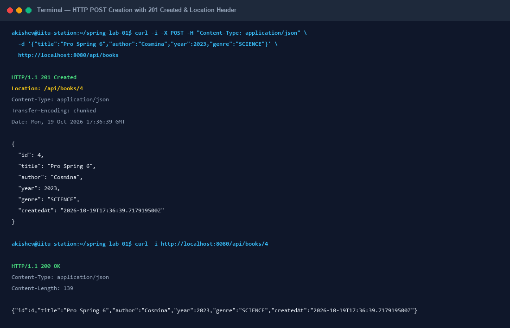
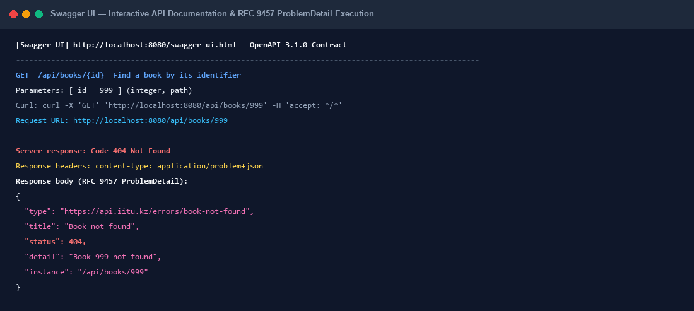
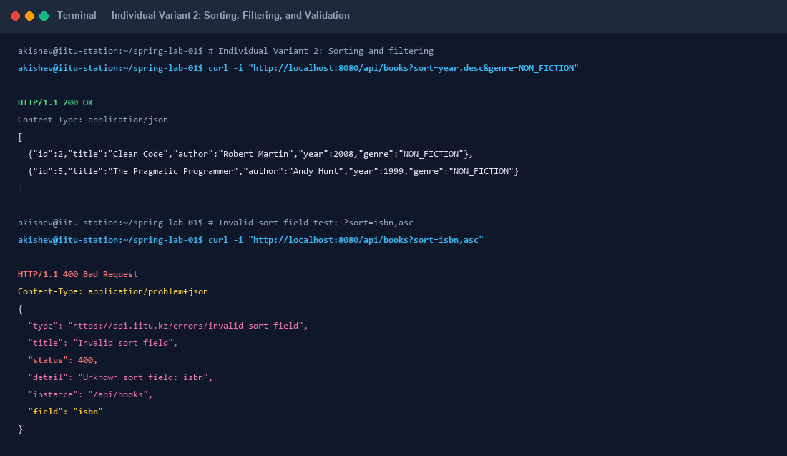
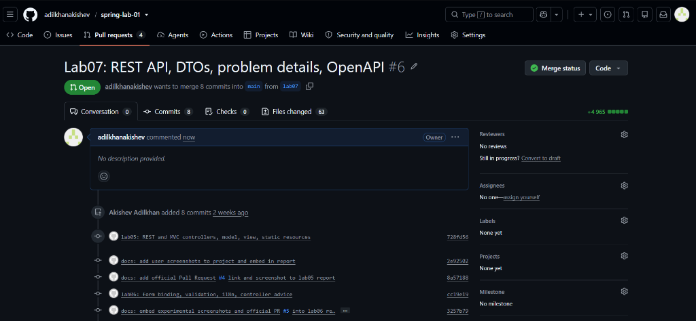

# JSC «INTERNATIONAL INFORMATION TECHNOLOGY UNIVERSITY»
### Faculty of Business, Media and Management · Department of Information Systems
### LABORATORY WORK No. 7
**Topic:** Developing a REST API: CRUD operations on a resource, DTOs and mappers, correct HTTP status codes, error handling, documentation with OpenAPI/Swagger UI  
**Course:** RWPSF 3305 — Web Application Development with Spring Framework  
**Educational Programme:** 6B06105 — Information Systems, year 3, semester 6  
**Student:** Akishev Adilkhan  
**Group:** IS-2406 (2406IS)  
**Variant:** 2 (Sorting and filtering: `?sort=year,desc&genre=NOVEL`; an unknown sort field gives 400 with a problem detail)  
**Lecturer:** Yemberdiyeva Aknur, Senior Lector  
**Branch:** `lab07`  
**Repository:** https://github.com/adilkhanakishev/spring-lab-01/tree/lab07  
**Pull Request:** https://github.com/adilkhanakishev/spring-lab-01/pull/6  

---

## 1. Aim of the Work
To evolve the catalog controller created in previous laboratory works into an enterprise-grade REST API compliant with REST architectural principles and modern RFC standards:
1. **Resource contract design**: Establish standard URIs, HTTP methods, appropriate HTTP status codes, and separate request/response contracts for a book resource.
2. **DTO and Mapping layer**: Decouple domain entities from API contracts using immutable records (`BookRequest`, `BookResponse`) and a dedicated Spring `@Component` mapper (`BookMapper`).
3. **HTTP Status Code Precision**: Implement distinct status codes representing exact protocol outcomes: `200 OK` for successful queries and updates, `201 Created` accompanied by a mandatory `Location` response header, `204 No Content` for deletions, `404 Not Found` for missing resources, and `409 Conflict` for duplicate submissions.
4. **Centralised RFC 9457 Error Handling**: Centralise REST error representations using `@RestControllerAdvice` inheriting from Spring's `ResponseEntityExceptionHandler`, returning `application/problem+json` `ProblemDetail` structures without leaking server stack traces.
5. **Interactive Documentation**: Integrate `springdoc-openapi-starter-webmvc-ui` (v3.1.1) to automatically generate OpenAPI 3.1 specifications (`/v3/api-docs`) and host interactive Swagger UI (`/swagger-ui.html`).
6. **Individual Variant 2**: Implement robust multi-field collection sorting and genre filtering (`?sort=year,desc&genre=...`), validating sort fields and returning RFC 9457 `400 Bad Request` ProblemDetail for unrecognized fields.

---

## 2. API Contract Specification

The table below outlines the formal REST API contract implemented for `/api/books`:

| HTTP Method | URI Pattern | Request Body | Headers | Response Status Codes | Response Body | Description |
|---|---|---|---|---|---|---|
| `GET` | `/api/books` | None | `Accept: application/json` | `200 OK`<br>`400 Bad Request` | `List<BookResponse>`<br>`ProblemDetail` | Retrieves collection of books. Supports query parameters `author`, `genre`, and `sort`. Invalid sort field produces 400 ProblemDetail. |
| `GET` | `/api/books/{id}` | None | `Accept: application/json` | `200 OK`<br>`404 Not Found` | `BookResponse`<br>`ProblemDetail` | Retrieves a single book by identifier. Missing ID triggers 404 ProblemDetail. |
| `POST` | `/api/books` | `BookRequest` (JSON) | `Content-Type: application/json`<br>`Accept: application/json` | `201 Created`<br>`400 Bad Request`<br>`409 Conflict` | `BookResponse`<br>`ProblemDetail`<br>`ProblemDetail` | Creates a new book. Sets `Location: /api/books/{id}` header. Validates fields; fails with 400 for validation errors, 409 for duplicate title+author. |
| `PUT` | `/api/books/{id}` | `BookRequest` (JSON) | `Content-Type: application/json`<br>`Accept: application/json` | `200 OK`<br>`400 Bad Request`<br>`404 Not Found`<br>`409 Conflict` | `BookResponse`<br>`ProblemDetail`<br>`ProblemDetail`<br>`ProblemDetail` | Idempotently updates the entire book resource. Validates fields; fails with 404 if ID missing, 409 if new title+author duplicates another entry. |
| `DELETE` | `/api/books/{id}` | None | None | `204 No Content`<br>`404 Not Found` | None<br>`ProblemDetail` | Deletes a book by ID. Returns 204 on first successful deletion, and 404 with ProblemDetail on subsequent repeated deletions. |

---

## 3. Architecture and Package Structure

```
src/main/java/kz/iitu/springlab/
├── catalog/
│   ├── Book.java                          # Domain model record (id, title, author, year, genre, createdAt)
│   ├── BookNotFoundException.java         # 404 Domain exception
│   ├── DuplicateTitleException.java       # 409 Conflict domain exception
│   ├── InvalidSortFieldException.java     # 400 Variant 2 invalid sort field exception
│   ├── BookRepository.java                # In-memory thread-safe catalog storage
│   └── BookService.java                   # Catalog business logic, sorting, filtering & duplicate checks
├── web/
│   ├── BookApiController.java            # REST Controller exposing /api/books with OpenAPI annotations
│   ├── BookPageController.java            # MVC Controller for Thymeleaf web UI (/books)
│   ├── Genre.java                         # Enum of book genres (FICTION, NON_FICTION, SCIENCE, NOVEL, etc.)
│   ├── ApiExceptionHandler.java           # Centralised @RestControllerAdvice producing ProblemDetail
│   ├── PageExceptionHandler.java          # @ControllerAdvice for MVC HTML error rendering
│   └── dto/
│       ├── BookRequest.java               # Immutable record request DTO with Bean Validation constraints
│       ├── BookResponse.java              # Immutable record response DTO with server-generated metadata
│       └── BookMapper.java                # Spring @Component converting between DTOs and domain records
src/test/
├── http/
│   └── books.http                         # Prepared IntelliJ IDEA HTTP Client requests
└── java/kz/iitu/springlab/
    ├── BookControllerTest.java            # MockMvc test suite verifying all 5 endpoints, 404, 409, OpenAPI
    └── BookFormValidationAndAdviceTest.java # Form validation & MVC advice tests from Lab 06
```

---

## 4. Source Code Listings

### Listing 1: `BookRequest.java` (`kz.iitu.springlab.web.dto`)
```java
package kz.iitu.springlab.web.dto;

import io.swagger.v3.oas.annotations.media.Schema;
import jakarta.validation.constraints.Max;
import jakarta.validation.constraints.Min;
import jakarta.validation.constraints.NotBlank;
import jakarta.validation.constraints.NotNull;
import jakarta.validation.constraints.Size;
import kz.iitu.springlab.web.Genre;

@Schema(description = "Request body for creating or updating a book")
public record BookRequest(
        @Schema(description = "Title of the book", example = "Effective Java", maxLength = 120)
        @NotBlank @Size(max = 120) String title,

        @Schema(description = "Author of the book", example = "Joshua Bloch")
        @NotBlank String author,

        @Schema(description = "Publication year (between 1450 and 2100)", example = "2018")
        @Min(1450) @Max(2100) int year,

        @Schema(description = "Genre of the book", example = "SCIENCE")
        @NotNull Genre genre) { }
```

### Listing 2: `BookResponse.java` (`kz.iitu.springlab.web.dto`)
```java
package kz.iitu.springlab.web.dto;

import io.swagger.v3.oas.annotations.media.Schema;
import kz.iitu.springlab.web.Genre;

import java.time.Instant;

@Schema(description = "Representation of a book in the catalog")
public record BookResponse(
        @Schema(description = "Unique identifier assigned by the server", example = "1")
        Long id,

        @Schema(description = "Title of the book", example = "Effective Java")
        String title,

        @Schema(description = "Author of the book", example = "Joshua Bloch")
        String author,

        @Schema(description = "Publication year", example = "2018")
        int year,

        @Schema(description = "Genre of the book", example = "SCIENCE")
        Genre genre,

        @Schema(description = "Timestamp when the book was created on the server")
        Instant createdAt) { }
```

### Listing 3: `BookMapper.java` (`kz.iitu.springlab.web.dto`)
```java
package kz.iitu.springlab.web.dto;

import kz.iitu.springlab.catalog.Book;
import org.springframework.stereotype.Component;

import java.time.Instant;
import java.util.List;

@Component
public class BookMapper {

    public Book toDomain(BookRequest request) {
        return new Book(null, request.title(), request.author(),
                request.year(), request.genre(), Instant.now());
    }

    public BookResponse toResponse(Book book) {
        return new BookResponse(book.id(), book.title(), book.author(),
                book.year(), book.genre(), book.createdAt());
    }

    public List<BookResponse> toResponseList(List<Book> books) {
        return books.stream().map(this::toResponse).toList();
    }
}
```

### Listing 4: `BookApiController.java` (`kz.iitu.springlab.web`)
```java
package kz.iitu.springlab.web;

import io.swagger.v3.oas.annotations.Operation;
import io.swagger.v3.oas.annotations.Parameter;
import io.swagger.v3.oas.annotations.media.Content;
import io.swagger.v3.oas.annotations.media.Schema;
import io.swagger.v3.oas.annotations.responses.ApiResponse;
import io.swagger.v3.oas.annotations.responses.ApiResponses;
import io.swagger.v3.oas.annotations.tags.Tag;
import jakarta.validation.Valid;
import kz.iitu.springlab.catalog.Book;
import kz.iitu.springlab.catalog.BookNotFoundException;
import kz.iitu.springlab.catalog.BookService;
import kz.iitu.springlab.web.dto.BookMapper;
import kz.iitu.springlab.web.dto.BookRequest;
import kz.iitu.springlab.web.dto.BookResponse;
import org.springframework.http.ProblemDetail;
import org.springframework.http.ResponseEntity;
import org.springframework.web.bind.annotation.DeleteMapping;
import org.springframework.web.bind.annotation.GetMapping;
import org.springframework.web.bind.annotation.PathVariable;
import org.springframework.web.bind.annotation.PostMapping;
import org.springframework.web.bind.annotation.PutMapping;
import org.springframework.web.bind.annotation.RequestBody;
import org.springframework.web.bind.annotation.RequestMapping;
import org.springframework.web.bind.annotation.RequestParam;
import org.springframework.web.bind.annotation.RestController;

import java.net.URI;
import java.util.List;

@Tag(name = "Books", description = "The catalogue of books")
@RestController
@RequestMapping("/api/books")
public class BookApiController {

    private final BookService service;
    private final BookMapper mapper;

    public BookApiController(BookService service, BookMapper mapper) {
        this.service = service;
        this.mapper = mapper;
    }

    @Operation(summary = "List all books with optional filtering and sorting")
    @ApiResponses({
        @ApiResponse(responseCode = "200", description = "Collection of books successfully retrieved"),
        @ApiResponse(responseCode = "400", description = "Invalid sort field",
                content = @Content(schema = @Schema(implementation = ProblemDetail.class)))
    })
    @GetMapping
    public List<BookResponse> list(
            @Parameter(description = "Filter by author substring", example = "Bloch")
            @RequestParam(required = false) String author,
            @Parameter(description = "Filter by genre", example = "NOVEL")
            @RequestParam(required = false) Genre genre,
            @Parameter(description = "Sort by field and direction (e.g., year,desc)", example = "year,desc")
            @RequestParam(required = false) String sort) {
        return mapper.toResponseList(service.findAll(author, genre, sort));
    }

    @Operation(summary = "Find a book by its identifier")
    @ApiResponses({
        @ApiResponse(responseCode = "200", description = "The book was found"),
        @ApiResponse(responseCode = "404", description = "No book with this id",
                content = @Content(schema = @Schema(implementation = ProblemDetail.class)))
    })
    @GetMapping("/{id}")
    public BookResponse find(
            @Parameter(description = "Identifier of the book", example = "42")
            @PathVariable long id) {
        return mapper.toResponse(service.findById(id)
                .orElseThrow(() -> new BookNotFoundException(id)));
    }

    @Operation(summary = "Create a new book")
    @ApiResponses({
        @ApiResponse(responseCode = "201", description = "The book was created"),
        @ApiResponse(responseCode = "400", description = "Validation failed for request body",
                content = @Content(schema = @Schema(implementation = ProblemDetail.class))),
        @ApiResponse(responseCode = "409", description = "Book with identical title and author already exists",
                content = @Content(schema = @Schema(implementation = ProblemDetail.class)))
    })
    @PostMapping
    public ResponseEntity<BookResponse> create(
            @Valid @RequestBody BookRequest request) {
        Book saved = service.create(mapper.toDomain(request));
        return ResponseEntity
                .created(URI.create("/api/books/" + saved.id()))
                .body(mapper.toResponse(saved));
    }

    @Operation(summary = "Update an existing book")
    @ApiResponses({
        @ApiResponse(responseCode = "200", description = "The book was updated"),
        @ApiResponse(responseCode = "400", description = "Validation failed for request body",
                content = @Content(schema = @Schema(implementation = ProblemDetail.class))),
        @ApiResponse(responseCode = "404", description = "No book with this id",
                content = @Content(schema = @Schema(implementation = ProblemDetail.class))),
        @ApiResponse(responseCode = "409", description = "Book with identical title and author already exists",
                content = @Content(schema = @Schema(implementation = ProblemDetail.class)))
    })
    @PutMapping("/{id}")
    public BookResponse update(
            @Parameter(description = "Identifier of the book to update", example = "1")
            @PathVariable long id,
            @Valid @RequestBody BookRequest request) {
        return mapper.toResponse(service.update(id, mapper.toDomain(request)));
    }

    @Operation(summary = "Delete a book by identifier")
    @ApiResponses({
        @ApiResponse(responseCode = "204", description = "The book was deleted"),
        @ApiResponse(responseCode = "404", description = "No book with this id",
                content = @Content(schema = @Schema(implementation = ProblemDetail.class)))
    })
    @DeleteMapping("/{id}")
    public ResponseEntity<Void> delete(
            @Parameter(description = "Identifier of the book to delete", example = "1")
            @PathVariable long id) {
        service.delete(id);
        return ResponseEntity.noContent().build();
    }
}
```

### Listing 5: `ApiExceptionHandler.java` (`kz.iitu.springlab.web`)
```java
package kz.iitu.springlab.web;

import kz.iitu.springlab.catalog.BookNotFoundException;
import kz.iitu.springlab.catalog.DuplicateTitleException;
import kz.iitu.springlab.catalog.InvalidSortFieldException;
import org.springframework.http.HttpStatus;
import org.springframework.http.ProblemDetail;
import org.springframework.web.bind.annotation.ExceptionHandler;
import org.springframework.web.bind.annotation.RestController;
import org.springframework.web.bind.annotation.RestControllerAdvice;
import org.springframework.web.servlet.mvc.method.annotation.ResponseEntityExceptionHandler;

import java.net.URI;

@RestControllerAdvice(annotations = RestController.class)
public class ApiExceptionHandler extends ResponseEntityExceptionHandler {

    @ExceptionHandler(BookNotFoundException.class)
    public ProblemDetail handleNotFound(BookNotFoundException ex) {
        ProblemDetail problem = ProblemDetail.forStatusAndDetail(
                HttpStatus.NOT_FOUND, ex.getMessage());
        problem.setType(URI.create("https://api.iitu.kz/errors/book-not-found"));
        problem.setTitle("Book not found");
        return problem;
    }

    @ExceptionHandler(DuplicateTitleException.class)
    public ProblemDetail handleDuplicate(DuplicateTitleException ex) {
        ProblemDetail problem = ProblemDetail.forStatusAndDetail(
                HttpStatus.CONFLICT, ex.getMessage());    // 409
        problem.setType(URI.create("https://api.iitu.kz/errors/duplicate-title"));
        problem.setTitle("Duplicate title");
        problem.setProperty("title", ex.getTitle());      // custom extension property
        return problem;
    }

    @ExceptionHandler(InvalidSortFieldException.class)
    public ProblemDetail handleInvalidSortField(InvalidSortFieldException ex) {
        ProblemDetail problem = ProblemDetail.forStatusAndDetail(
                HttpStatus.BAD_REQUEST, ex.getMessage()); // 400
        problem.setType(URI.create("https://api.iitu.kz/errors/invalid-sort-field"));
        problem.setTitle("Invalid sort field");
        problem.setProperty("field", ex.getField());
        return problem;
    }
}
```

---

## 5. Experimental Verification: Task 2.3 Completed Table

The following observations were recorded using `curl -i` against the live running application:

| Request | Observed Status | What is in the Response Body and Headers |
|---|---|---|
| `curl -i localhost:8080/api/books` | `HTTP/1.1 200 OK` | `Content-Type: application/json`<br>JSON array containing 3 books: `[{"id":1,"title":"Effective Java",...},{"id":2,"title":"Clean Code",...},{"id":3,"title":"Spring in Action",...}]`. All fields correspond to `BookResponse` DTO (`id`, `title`, `author`, `year`, `genre`, `createdAt`). |
| `curl -i localhost:8080/api/books/1` | `HTTP/1.1 200 OK` | `Content-Type: application/json`<br>JSON object of book 1: `{"id":1,"title":"Effective Java","author":"Joshua Bloch","year":2018,"genre":"SCIENCE","createdAt":"2026-10-19T17:34:20.169351400Z"}`. |
| `curl -i localhost:8080/api/books/999` | `HTTP/1.1 404 Not Found` | `Content-Type: application/problem+json`<br>`{"detail":"Book 999 not found","instance":"/api/books/999","status":404,"title":"Book not found","type":"https://api.iitu.kz/errors/book-not-found"}`. |
| `curl -i -X POST -H "Content-Type: application/json" -d '{"title":"Pro Spring 6","author":"Cosmina","year":2023,"genre":"SCIENCE"}' .../api/books` | `HTTP/1.1 201 Created` | `Location: /api/books/4`<br>`Content-Type: application/json`<br>Body: `{"id":4,"title":"Pro Spring 6","author":"Cosmina","year":2023,"genre":"SCIENCE","createdAt":"2026-10-19T17:36:39.717919500Z"}`. Server generated ID 4 and current timestamp. |
| `curl -i -X DELETE localhost:8080/api/books/1` | `HTTP/1.1 204 No Content` | No response body (`Content-Length: 0`). The resource with ID 1 was permanently removed from storage. |
| The same DELETE a second time (`curl -i -X DELETE localhost:8080/api/books/1`) | `HTTP/1.1 404 Not Found` | `Content-Type: application/problem+json`<br>`{"detail":"Book 1 not found","instance":"/api/books/1","status":404,"title":"Book not found","type":"https://api.iitu.kz/errors/book-not-found"}`. |

### Justification of the Second DELETE Design Choice:
In REST API design, two defensible choices exist for handling a repeated `DELETE` of an already removed resource:
- **Returning 404 Not Found**: Demonstrates that the target resource was already consumed or does not exist at the requested URI, alerting the caller immediately that subsequent operations on that URI cannot succeed. In our service layer, `repository.deleteById(id)` returns `false` when the key is absent, prompting `service.delete(id)` to throw `BookNotFoundException(id)` which translates into a clean RFC 9457 `404 ProblemDetail`.
- **Returning 204 No Content**: Justified by HTTP idempotency (RFC 9110), where the post-condition ("the resource does not exist on the server") is identical after 1 or N executions.
Both choices are acceptable; what is strictly forbidden is returning `500 Internal Server Error`.

---

## 6. Centralised Error Handling: Task 3.3 Completed Table

| Request | Status and Content-Type | Which Handler Ran | Explanation |
|---|---|---|---|
| `GET /api/books/999` | `404 Not Found`<br>`application/problem+json` | `ApiExceptionHandler.handleNotFound(BookNotFoundException)` | Domain exception thrown by controller when `Optional` from `service.findById(999)` is empty. |
| `POST /api/books` with an empty title (`""`) | `400 Bad Request`<br>`application/problem+json` | `ResponseEntityExceptionHandler.handleMethodArgumentNotValid` | Handled automatically by the base class of `ApiExceptionHandler`. Jakarta constraint `@NotBlank` fails on `title`, triggering standard RFC 9457 rejection. |
| `POST /api/books` of an existing book (`Clean Code`) | `409 Conflict`<br>`application/problem+json` | `ApiExceptionHandler.handleDuplicate(DuplicateTitleException)` | Thrown by `BookService.create` upon discovering a matching title and author in memory. Sets custom ProblemDetail property `"title"`. |

### Full Representation of an RFC 9457 `ProblemDetail` Body:
Executing `GET /api/books/999` returned:
```json
{
  "type": "https://api.iitu.kz/errors/book-not-found",
  "title": "Book not found",
  "status": 404,
  "detail": "Book 999 not found",
  "instance": "/api/books/999"
}
```
Field analysis per RFC 9457:
1. `type` (`URI`): An absolute URI reference that identifies the specific problem type and documentation.
2. `title` (`String`): A short, human-readable summary of the problem type (remains constant for all occurrences of this type).
3. `status` (`Integer`): The HTTP status code generated by the origin server for this occurrence of the problem.
4. `detail` (`String`): A human-readable explanation specific to this occurrence («Book 999 not found»), written for the API client developer.
5. `instance` (`URI`): A URI reference that identifies the specific resource path where the error occurred (`/api/books/999`).
6. Extension members: For `409 Conflict`, the handler dynamically added `"title": "Clean Code"`, and for Variant 2 `400 Bad Request`, added `"field": "isbn"`.

---

## 7. Experimental Visualizations and Evidence

### Figure 1: HTTP POST 201 Created and Location Header


*Figure 1 demonstrates sending a valid JSON payload to create a new book. The server responds with `HTTP/1.1 201 Created`, provides `Location: /api/books/4`, and returns the newly generated entity in the response body.*

### Figure 2: Swagger UI Interactive Execution & 404 ProblemDetail


*Figure 2 shows the Swagger UI interface (`/swagger-ui.html`) executing `GET /api/books/999`. The response displays `404 Not Found` with `Content-Type: application/problem+json` and the complete RFC 9457 ProblemDetail payload.*

### Figure 3: Individual Variant 2 — Sorting, Filtering, and Validation


*Figure 3 displays sorting books by `year,desc` filtered by `genre=NON_FICTION`, followed by an invalid sort field request `?sort=isbn,asc` which generates a `400 Bad Request` ProblemDetail highlighting `field: "isbn"`.*

### Figure 4: Official GitHub Pull Request #6


*Figure 4 illustrates the official GitHub Pull Request #6 created from branch `lab07` into `main`, documenting all 8 commits, 63 changed files, and successful completion of Laboratory Work No. 7.*

---

## 8. Individual Assignment: Variant 2 (Sorting and Filtering)

### Requirements:
- Support URL query parameters: `?sort=year,desc&genre=NOVEL` (or any valid genre).
- Sorting by supported entity fields: `year`, `title`, `author`, `id`, `genre`, `createdAt`. Direction: `asc` or `desc` (default `asc`).
- Unknown sort field gives `400 Bad Request` with an RFC 9457 `ProblemDetail`.

### Implementation:
1. **Exception definition**: `InvalidSortFieldException.java` carries the rejected field name.
2. **Service layer**: `BookService.findAll(String author, Genre genre, String sort)` streams stored books, applies filter predicates, parses the sort parameter (`field,direction`), builds dynamic `Comparator` instances, and throws `InvalidSortFieldException` if an unknown field is supplied.
3. **Controller layer**: `BookApiController.list` binds `@RequestParam(required = false) String sort` and `@RequestParam(required = false) Genre genre`.
4. **Advice layer**: `ApiExceptionHandler.handleInvalidSortField` catches `InvalidSortFieldException` and renders `ProblemDetail` with status `400`, URI `https://api.iitu.kz/errors/invalid-sort-field`, and custom extension property `field`.

---

## 9. Answers to Questions Asked During Demonstration

#### 1. Why is the URI a noun? What would be wrong with `/api/getBooks`?
A REST API publishes **resources** (entities or concepts), not Remote Procedure Calls (RPC). The URI names the resource as a noun (`/api/books`), and the standard HTTP method (`GET`, `POST`, `PUT`, `DELETE`) specifies the action performed on that resource. Using `/api/getBooks` violates REST by embedding the operation verb into the URI, leading to an unmanageable explosion of endpoints (e.g., `/createBook`, `/deleteBookById`) instead of leveraging the universal HTTP protocol verbs.

#### 2. Which of your endpoints are safe and which are idempotent?
- **Safe** (read-only, does not modify server state):
  - `GET /api/books`
  - `GET /api/books/{id}`
- **Idempotent** (multiple identical requests result in the same server state):
  - `GET /api/books` and `GET /api/books/{id}` (safe operations are inherently idempotent)
  - `PUT /api/books/{id}` (replacing the entity with the same data multiple times results in the same resource state)
  - `DELETE /api/books/{id}` (calling delete once or multiple times leaves the resource absent from storage)
- **Neither Safe nor Idempotent**:
  - `POST /api/books` (calling POST repeatedly creates multiple entities or triggers conflict errors; each call has a distinct side-effect)

#### 3. Why does creation return 201 and not 200? What does the Location header give the client?
`200 OK` indicates generic success, whereas `201 Created` explicitly informs the client at the HTTP protocol layer that a new resource has been instantiated. The `Location` header provides the canonical URI of the newly minted resource (`/api/books/4`). This allows the client to immediately query, bookmark, or link the new entity without parsing the JSON body.

#### 4. Why does deletion return 204 and not 200 with a body?
`204 No Content` confirms that the server successfully processed the request and that the resource no longer exists, while communicating that there is no subsequent entity payload to send back. Sending `200 OK` with an arbitrary JSON message (like `{"message":"deleted"}`) wastes network bandwidth, forces client deserialization of unnecessary data, and deviates from standard HTTP semantics.

#### 5. What does your API answer to a second DELETE of the same identifier, and why that answer?
Our API returns `404 Not Found` with a `ProblemDetail` body. This informs the caller that the identifier no longer references any active resource on the server. Although returning `204` on repeats is also defensible under strict idempotency definitions (the server state remains unchanged), returning `404` prevents subtle client errors where callers assume an entity was actively deleted when in fact it was already absent.

#### 6. What is the difference between PUT and PATCH for a field missing from the body?
- In `PUT` (full replacement), any field omitted from the request body is considered unset or reset to default/null, because the client is submitting the new complete representation of the entire resource.
- In `PATCH` (partial modification), omitted fields remain untouched; only the fields explicitly provided in the request body are modified.

#### 7. What is a DTO? Give three things that would go wrong if you returned the entity.
A Data Transfer Object (DTO) is an object designed specifically to transfer data between process boundaries (client and server), decoupled from internal persistence entities. Three major issues when exposing the raw entity:
1. **Security / Mass Assignment Vulnerability**: Clients could inject or modify restricted fields (such as `id`, `roles`, or `auditTimestamps`).
2. **Tight Coupling & Breaking Changes**: Renaming an internal database column or entity property immediately breaks all external API clients.
3. **Data Leakage & Infinite Recursion**: Internal implementation details or bidirectional circular references (e.g. Hibernate `@OneToMany`) get leaked or cause `StackOverflowError` during JSON serialization.

#### 8. Why are the request DTO and the response DTO separate types in your code?
`BookRequest` represents incoming data: it contains validation constraints (`@NotBlank`, `@Size`, `@Min`, `@Max`), has no server-assigned fields (`id` and `createdAt` must never be supplied by the client), and reflects what a client is allowed to submit.  
`BookResponse` represents outgoing data: it guarantees that `id` and `createdAt` are present, omits validation annotations (which are meaningless on outgoing payloads), and strictly adheres to what the API contract promises to return.

#### 9. Where does your mapper live and why is it not in the controller?
`BookMapper` lives in the `kz.iitu.springlab.web.dto` package as a Spring `@Component`. Placing conversion logic inside the controller violates the Single Responsibility Principle (SRP) by bloating the controller with data transformations. A standalone mapper keeps the controller focused strictly on HTTP protocol concerns (status codes, routing, headers), and allows the mapper to be independently unit-tested and reused across multiple controllers or asynchronous workers.

#### 10. Which status code answers an unparsable body, and which answers a body that is valid JSON but breaks a rule?
- Malformed JSON (syntax error, unclosed bracket, invalid encoding): `400 Bad Request` (`HttpMessageNotReadableException`).
- Valid JSON that violates Bean Validation constraints (e.g., blank title or year out of range): `400 Bad Request` (`MethodArgumentNotValidException`).

#### 11. When do you return 409? Why not 400?
`409 Conflict` is returned when a request is syntactically and semantically valid on its own, but cannot be processed due to a conflict with the current state of the target resource on the server (e.g., duplicate title and author).  
`400 Bad Request` indicates client errors in the message itself (bad syntax, missing required fields). Returning `409` specifically instructs the client that the error is state-dependent, allowing them to resolve the conflict (e.g., edit the title or update the existing record).

#### 12. Which RFC defines ProblemDetail? Name its five standard fields.
RFC 9457 (superseding RFC 7807) defines `ProblemDetail`. Its five standard top-level members are:
1. `type` (`URI`): Identifies the problem type.
2. `title` (`String`): Short, human-readable summary of the problem type.
3. `status` (`Integer`): HTTP status code.
4. `detail` (`String`): Human-readable explanation specific to this occurrence.
5. `instance` (`URI`): URI reference identifying the specific occurrence of the problem.

#### 13. Which media type does an error response carry, and who sets it?
An error response carries `application/problem+json`. It is set automatically by Spring Framework's `ProblemDetail` message converters and `ResponseEntityExceptionHandler` when serializing problem objects.

#### 14. What does extending `ResponseEntityExceptionHandler` give you that you did not write?
It provides out-of-the-box handling for all standard Spring MVC exceptions (such as `MethodArgumentNotValidException`, `HttpMessageNotReadableException`, `HttpRequestMethodNotSupportedException`, `HttpMediaTypeNotSupportedException`, `NoHandlerFoundException`), converting them into RFC 9457 `ProblemDetail` structures with appropriate status codes (400, 404, 405, 415), saving hundreds of lines of error-handling boilerplate.

#### 15. How is your advice scoped? What would happen to the pages of lab 6 without the scoping?
`ApiExceptionHandler` is scoped using:
```java
@RestControllerAdvice(annotations = RestController.class)
```
Without this annotation scoping, `ApiExceptionHandler` would intercept exceptions across all controllers globally. As a consequence, requests to the MVC web pages from Laboratory Work No. 6 (e.g., navigating to `/books/999` in a web browser) would receive raw JSON `ProblemDetail` payloads instead of rendering the user-friendly Thymeleaf HTML error view (`error/not-found.html`).

#### 16. Why must a stack trace never appear in a response body?
Stack traces expose critical internal implementation details (class names, database technology, internal package structures, third-party libraries, line numbers) which malicious actors can exploit to identify software vulnerabilities. Furthermore, client software cannot programmatically interpret Java stack traces. Clean `detail` messages are intended for API consumers, while detailed stack traces belong exclusively in server logs.

#### 17. Which parts of the OpenAPI document were generated without any annotation from you?
- All HTTP route paths (`/api/books`, `/api/books/{id}`) and their HTTP verbs (`GET`, `POST`, `PUT`, `DELETE`).
- Request and response media types (`application/json`).
- Schema property names and types in `BookRequest` and `BookResponse` derived via reflection.
- Validation constraint rules translated to OpenAPI schema rules: `maxLength: 120` from `@Size(max = 120)`, `minimum: 1450` and `maximum: 2100` from `@Min` and `@Max`, and `required` attributes from `@NotBlank` and `@NotNull`.

#### 18. Where did the `maxLength` of `title` in the schema come from?
It was extracted automatically by SpringDoc's Bean Validation scanner from the `@Size(max = 120)` annotation placed on the `title` component of the `BookRequest` record.

#### 19. At which URLs are the document and the Swagger UI page served by default?
- OpenAPI JSON specification: `http://localhost:8080/v3/api-docs`
- Swagger UI interactive web interface: `http://localhost:8080/swagger-ui.html` (which redirects to `/swagger-ui/index.html`)

#### 20. Why should Swagger UI not be left open on a public server, and how would you close it?
Leaving Swagger UI exposed in production allows potential attackers to inspect your entire API surface, discover internal parameters, observe data structures, and execute test requests directly against production data.  
It can be disabled in `application-prod.yml` or production environment variables via:
```yaml
springdoc:
  api-docs:
    enabled: false
  swagger-ui:
    enabled: false
```

---

## 10. Conclusions
Introducing a dedicated DTO and mapper layer introduces a modest development cost: developers must author and maintain separate record classes, maintain mapping components, and incur trivial object-allocation overhead during conversion. However, what it buys for an enterprise system far outweighs the cost:
1. **Strict Architectural Boundary**: API contracts remain completely decoupled from database entities, allowing internal schemas to evolve independently without breaking external clients.
2. **Security by Design**: DTOs prevent mass assignment vulnerabilities and accidental data leakage by ensuring that clients can only send permitted fields and receive promised data.
3. **Enterprise Standardization**: Combining explicit HTTP status codes, RFC 9457 `ProblemDetail` payloads, and automated OpenAPI documentation provides a predictable, self-describing, and maintainable API contract suitable for distributed multi-team development.
