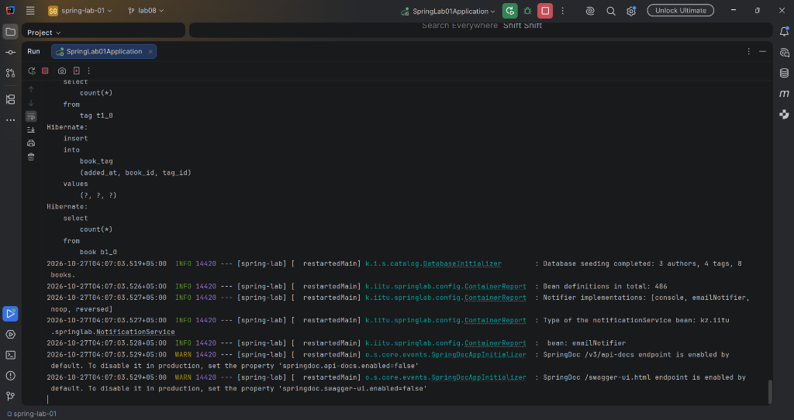
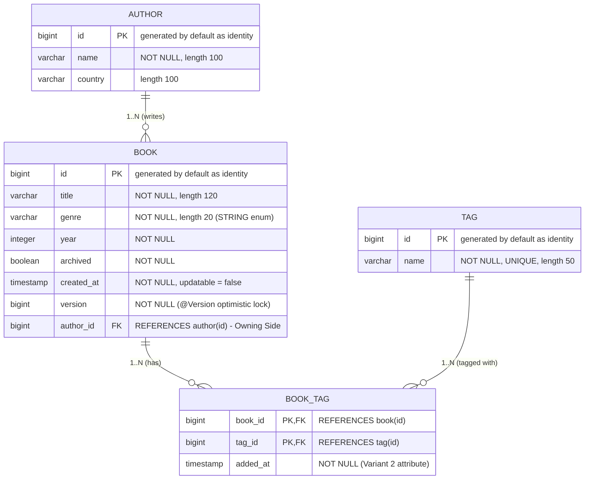
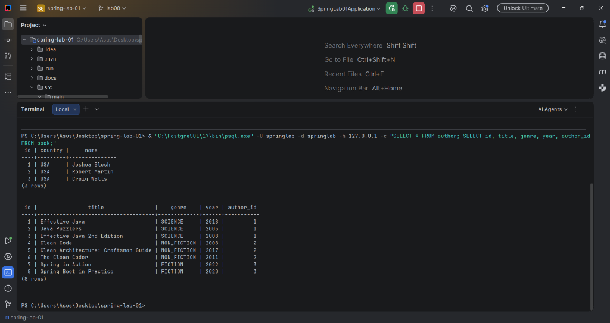
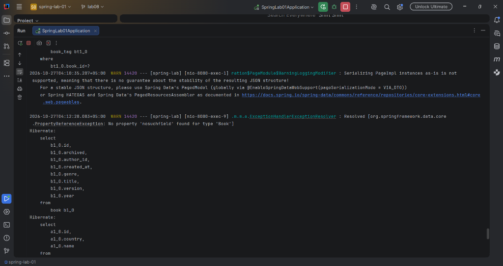
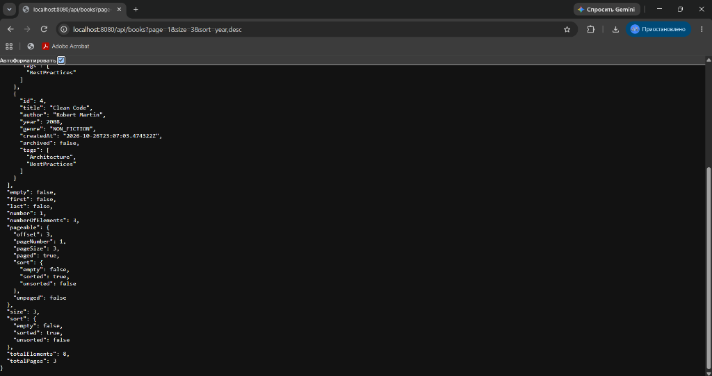
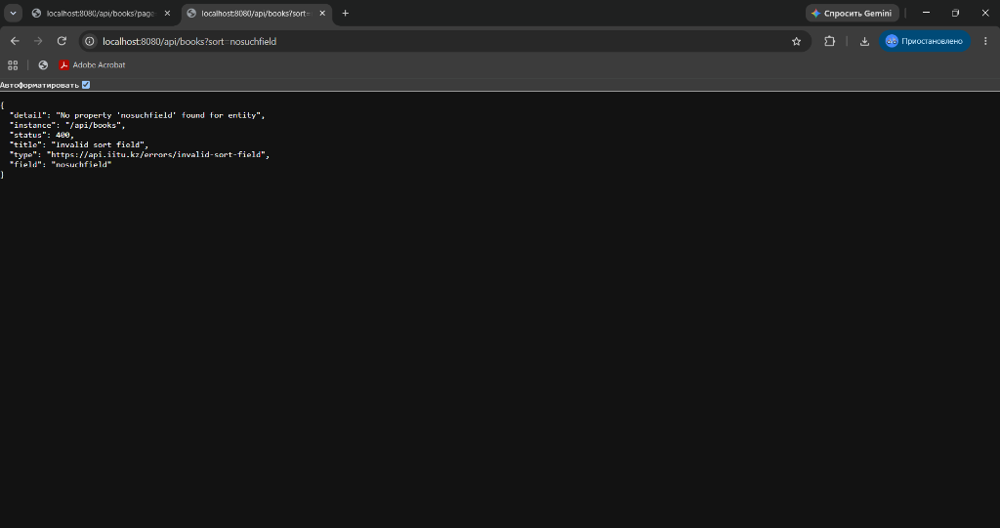
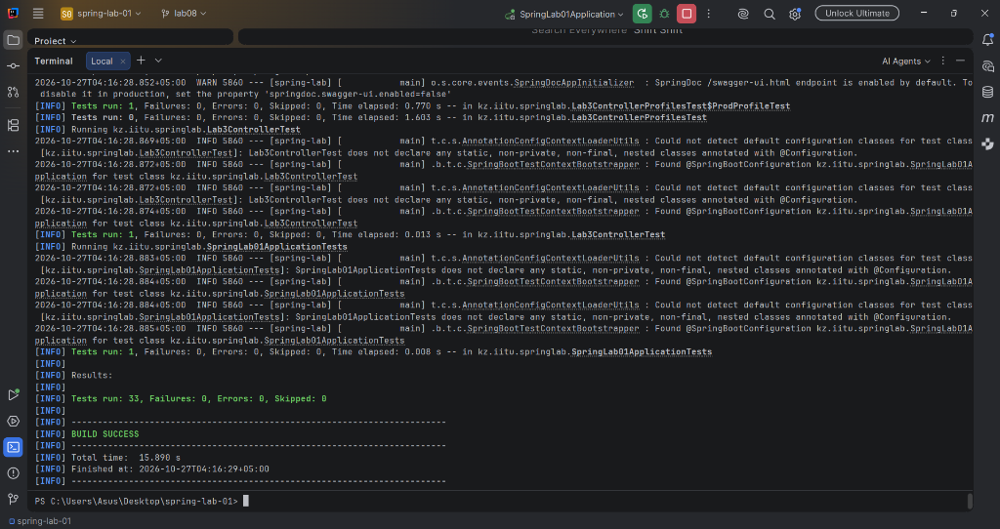
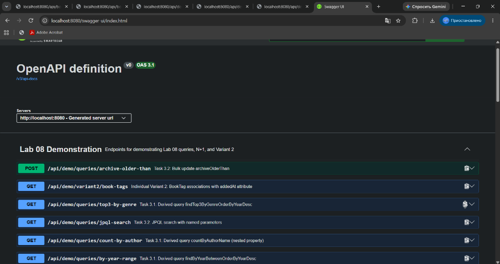
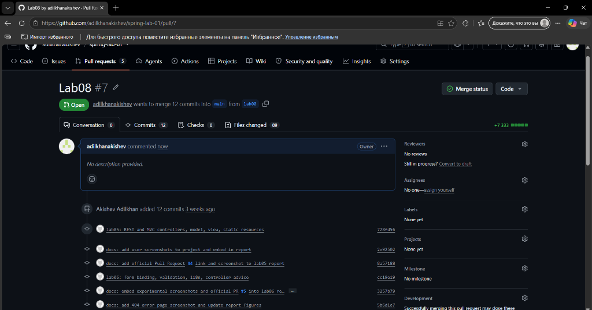

# JSC «INTERNATIONAL INFORMATION TECHNOLOGY UNIVERSITY»
### Faculty of Business, Media and Management · Department of Information Systems
### LABORATORY WORK No. 8
**Topic:** The data access layer: connecting PostgreSQL, entities and associations (@OneToMany, @ManyToMany), Spring Data JPA repositories, derived and JPQL queries, pagination and sorting  
**Course:** RWPSF 3305 — Web Application Development with Spring Framework  
**Educational Programme:** 6B06105 — Information Systems, year 3, semester 6  
**Student:** Akishev Adilkhan  
**Group:** IS-2406 (2406IS)  
**Variant:** 2 (A @ManyToMany with attributes: A `BookTag` entity with an added `addedAt` column instead of a plain join table)  
**Lecturer:** Yemberdiyeva Aknur, Senior Lector  
**Branch:** `lab08`  
**Repository:** https://github.com/adilkhanakishev/spring-lab-01/tree/lab08
**Pull Request:** https://github.com/adilkhanakishev/spring-lab-01/pull/7  

---

## 1. Aim of the Work



The objective of this laboratory work is to replace the in-memory map/list storage that carried the catalogue resource in previous laboratory works with a production-grade relational database management system (PostgreSQL 17). By completing this work:
1. The application connects to PostgreSQL using HikariCP connection pooling and Spring Data JPA / Hibernate ORM with the `create-drop` DDL schema strategy.
2. The domain model is transformed from Java records into persistent JPA entities: `Book` (with identity ID, string-mapped enum, creation timestamp, optimistic locking version), `Author`, and `Tag`.
3. Associations are properly established:
   - A bidirectional `@ManyToOne` (owning side on `Book`) and `@OneToMany` (inverse side on `Author` with `mappedBy`, `CascadeType.ALL`, `orphanRemoval = true`, and defensive `addBook()` synchronization helper).
   - An attributed `@ManyToMany` association represented by the `BookTag` entity containing a composite primary key (`@EmbeddedId BookTagId`) and an additional `addedAt` timestamp column (Individual Variant 2).
4. Spring Data JPA repository features are implemented: five derived queries, JPQL query with named parameters, `@Modifying` bulk update with `clearAutomatically = true`, and the N+1 problem is analyzed and resolved using `join fetch` and `@EntityGraph`.
5. The REST API collection endpoint is upgraded from returning an unpaged list to returning a paginated and sorted `Page<BookResponse>` with total count metadata, and compared against `Slice<BookResponse>`.

---

## 2. Entity-Relationship Architecture Diagram



### Cardinality and Owning Side Breakdown:
1. **Author ↔ Book**:
   - Cardinality: One-to-Many (`1:N`).
   - Owning side: `Book` (declares `@ManyToOne(fetch = FetchType.LAZY)` and `@JoinColumn(name = "author_id")`). The physical foreign key column `author_id` resides exclusively in the `book` table.
   - Inverse side: `Author` (declares `@OneToMany(mappedBy = "author")`). Contains no physical foreign key column.
2. **Book ↔ Tag (Individual Variant 2: Attributed Many-to-Many)**:
   - Upgraded from a plain `@ManyToMany` join table to a first-class JPA entity `BookTag` with `@EmbeddedId BookTagId`.
   - Owning tables: `book_tag` holds foreign keys `book_id` (referencing `book(id)`) and `tag_id` (referencing `tag(id)`), as well as the custom attribute `added_at`.

---

## 3. Database Schema Verification (from PostgreSQL `psql`)

### 3.1. Tables List (`\dt`)
```sql
           List of relations
 Schema |   Name   | Type  |   Owner   
--------+----------+-------+-----------
 public | author   | table | springlab
 public | book     | table | springlab
 public | book_tag | table | springlab
 public | tag      | table | springlab
(4 rows)
```

### 3.2. Table `book` (`\d book`)
```sql
                                        Table "public.book"
   Column   |            Type             | Collation | Nullable |             Default              
------------+-----------------------------+-----------+----------+----------------------------------
 archived   | boolean                     |           | not null | 
 year       | integer                     |           | not null | 
 author_id  | bigint                      |           |          | 
 created_at | timestamp(6) with time zone |           |          | 
 id         | bigint                      |           | not null | generated by default as identity
 version    | bigint                      |           | not null | 
 genre      | character varying(20)       |           | not null | 
 title      | character varying(120)      |           | not null | 
Indexes:
    "book_pkey" PRIMARY KEY, btree (id)
Check constraints:
    "book_genre_check" CHECK (genre::text = ANY (ARRAY['FICTION'::character varying, 'NON_FICTION'::character varying, 'SCIENCE'::character varying, 'HISTORY'::character varying, 'BIOGRAPHY'::character varying, 'NOVEL'::character varying]::text[]))
Foreign-key constraints:
    "fkklnrv3weler2ftkweewlky958" FOREIGN KEY (author_id) REFERENCES author(id)
Referenced by:
    TABLE "book_tag" CONSTRAINT "fkdrc33u5ufw8rdvajeveowgx7g" FOREIGN KEY (book_id) REFERENCES book(id)
```

### 3.3. Table `book_tag` (`\d book_tag`)
```sql
                         Table "public.book_tag"
  Column  |            Type             | Collation | Nullable | Default 
----------+-----------------------------+-----------+----------+---------
 added_at | timestamp(6) with time zone |           | not null | 
 book_id  | bigint                      |           | not null | 
 tag_id   | bigint                      |           | not null | 
Indexes:
    "book_tag_pkey" PRIMARY KEY, btree (book_id, tag_id)
Foreign-key constraints:
    "fkdrc33u5ufw8rdvajeveowgx7g" FOREIGN KEY (book_id) REFERENCES book(id)
    "fkrxw4xl05l6ns1763bq284e7m2" FOREIGN KEY (tag_id) REFERENCES tag(id)
```

### 3.4. Table `author` (`\d author`)
```sql
                                   Table "public.author"
 Column  |          Type          | Collation | Nullable |             Default              
---------+------------------------+-----------+----------+----------------------------------
 id      | bigint                 |           | not null | generated by default as identity
 country | character varying(100) |           |          | 
 name    | character varying(100) |           | not null | 
Indexes:
    "author_pkey" PRIMARY KEY, btree (id)
Referenced by:
    TABLE "book" CONSTRAINT "fkklnrv3weler2ftkweewlky958" FOREIGN KEY (author_id) REFERENCES author(id)
```

### 3.5. Table `tag` (`\d tag`)
```sql
                                    Table "public.tag"
 Column |         Type          | Collation | Nullable |             Default              
--------+-----------------------+-----------+----------+----------------------------------
 id     | bigint                |           | not null | generated by default as identity
 name   | character varying(50) |           | not null | 
Indexes:
    "tag_pkey" PRIMARY KEY, btree (id)
    "tag_name_key" UNIQUE CONSTRAINT, btree (name)
Referenced by:
    TABLE "book_tag" CONSTRAINT "fkrxw4xl05l6ns1763bq284e7m2" FOREIGN KEY (tag_id) REFERENCES tag(id)
```

---

## 4. Completed Task 2.3 Verification Table

| Question | Your answer | How you checked it |
|---|---|---|
| **Which tables were created?** | 4 tables: `author`, `book`, `book_tag`, and `tag` | Checked using `\dt` in `psql` and verified Hibernate DDL logs during schema initialization. |
| **Where is the author foreign key?** | In the `book` table as column `author_id` referencing `author(id)` | Checked using `\d book` in `psql` (foreign key constraint `fkklnrv3weler2ftkweewlky958`). |
| **What columns does book_tag have?** | `book_id` (bigint), `tag_id` (bigint), and `added_at` (timestamp with time zone) | Checked using `\d book_tag` in `psql`. Demonstrates Variant 2 attribute on join table. |
| **Does author have a books column?** | No. The `author` table only contains `id`, `country`, and `name` | Checked using `\d author` in `psql`. The `books` collection in `Author` is mapped by `mappedBy = "author"` and has no column in `author`. |

---

## 5. Seed Data in the Database




The database was initialized via `DatabaseInitializer` (`CommandLineRunner`) with 3 authors, 8 books, and 4 tags, meeting all Task 2.2 requirements (at least one author owning 3 books, at least one book carrying 2 tags):

```sql
springlab=# SELECT id, name, country FROM author;
 id |     name      | country 
----+---------------+---------
  1 | Joshua Bloch  | USA
  2 | Robert Martin | USA
  3 | Craig Walls   | USA
(3 rows)

springlab=# SELECT id, title, genre, year, author_id, archived FROM book;
 id |                title                |    genre    | year | author_id | archived 
----+-------------------------------------+-------------+------+-----------+----------
  1 | Effective Java                      | SCIENCE     | 2018 |         1 | f
  2 | Java Puzzlers                       | SCIENCE     | 2005 |         1 | f
  3 | Effective Java 2nd Edition          | SCIENCE     | 2008 |         1 | f
  4 | Clean Code                          | NON_FICTION | 2008 |         2 | f
  5 | Clean Architecture: Craftsman Guide | NON_FICTION | 2017 |         2 | f
  6 | The Clean Coder                     | NON_FICTION | 2011 |         2 | f
  7 | Spring in Action                    | FICTION     | 2022 |         3 | f
  8 | Spring Boot in Practice             | FICTION     | 2020 |         3 | f
(8 rows)

springlab=# SELECT bt.book_id, b.title, bt.tag_id, t.name, bt.added_at FROM book_tag bt JOIN book b ON bt.book_id = b.id JOIN tag t ON bt.tag_id = t.id;
 book_id |                title                | tag_id |     name      |           added_at            
---------+-------------------------------------+--------+---------------+-------------------------------
       1 | Effective Java                      |      1 | Java          | 2026-10-27 03:50:44.643765+05
       1 | Effective Java                      |      3 | BestPractices | 2026-10-27 03:50:44.643765+05
       2 | Java Puzzlers                       |      1 | Java          | 2026-10-27 03:50:44.661824+05
       3 | Effective Java 2nd Edition          |      1 | Java          | 2026-10-27 03:50:44.673491+05
       4 | Clean Code                          |      2 | Architecture  | 2026-10-27 03:50:44.67903+05
       4 | Clean Code                          |      3 | BestPractices | 2026-10-27 03:50:44.67903+05
       5 | Clean Architecture: Craftsman Guide |      2 | Architecture  | 2026-10-27 03:50:44.686203+05
       6 | The Clean Coder                     |      3 | BestPractices | 2026-10-27 03:50:44.694929+05
       7 | Spring in Action                    |      1 | Java          | 2026-10-27 03:50:44.700035+05
       7 | Spring in Action                    |      4 | Spring        | 2026-10-27 03:50:44.700035+05
       8 | Spring Boot in Practice             |      4 | Spring        | 2026-10-27 03:50:44.705423+05
(11 rows)
```

---

## 6. Completed Task 3.3 Query Execution Table

| Method | Parameters / Description | Rows Returned | Number of SQL Statements |
|---|---|---|---|
| `findByGenre(Genre.SCIENCE)` | Derived query filtering by enum `SCIENCE` | 3 rows (`Effective Java`, `Java Puzzlers`, `Effective Java 2nd Edition`) | 1 |
| `findByTitleContainingIgnoreCase("clean")` | Derived query with case-insensitive LIKE pattern | 3 rows (`Clean Code`, `Clean Architecture: Craftsman Guide`, `The Clean Coder`) | 1 |
| `findByYearBetweenOrderByYearDesc(2005, 2020)` | Derived query filtering year range and sorting descending | 6 rows | 1 |
| `findTop3ByGenreOrderByYearDesc(Genre.SCIENCE)` | Derived query with `Top3` projection keyword and ordering | 3 rows | 1 |
| `countByAuthorName("Joshua Bloch")` | Derived query traversing nested entity path `book.author.name` | Scalar `3` | 1 |
| `search(Genre.SCIENCE, 2008)` | JPQL query with named parameters `:genre` and `:year` | 2 rows (`Effective Java`, `Effective Java 2nd Edition`) | 1 |
| `archiveOlderThan(2010)` | `@Modifying(clearAutomatically = true)` bulk UPDATE query | 3 rows updated | 1 |

### Generated SQL for Derived Query `findTop3ByGenreOrderByYearDesc`:
```sql
Hibernate: 
    select
        b1_0.id,
        b1_0.archived,
        b1_0.author_id,
        b1_0.created_at,
        b1_0.genre,
        b1_0.title,
        b1_0.version,
        b1_0.year 
    from
        book b1_0 
    where
        b1_0.genre=? 
    order by
        b1_0.year desc 
    fetch
        first ? rows only
```

### Generated SQL for Nested Property Query `countByAuthorName`:
```sql
Hibernate: 
    select
        count(b1_0.id) 
    from
        book b1_0 
    left join
        author a1_0 
            on a1_0.id=b1_0.author_id 
    where
        a1_0.name=?
```

### Generated SQL for JPQL Search Query:
```sql
Hibernate: 
    select
        b1_0.id,
        b1_0.archived,
        b1_0.author_id,
        b1_0.created_at,
        b1_0.genre,
        b1_0.title,
        b1_0.version,
        b1_0.year 
    from
        book b1_0 
    where
        b1_0.genre=? 
        and b1_0.year>=? 
    order by
        b1_0.title
```

### Generated SQL for Bulk Update Query:
```sql
Hibernate: 
    update
        book b1_0 
    set
        archived=true 
    where
        b1_0.year<?
```

---

## 7. The N+1 Exercise and Analysis (Task 3.4)




### 7.1. Query Counts Comparison

| Scenario | Java Call / Method | Total SQL Statements | Explanation |
|---|---|---|---|
| **Without Fetch Join** | `repository.findAll()` + `b.getAuthor().getName()` | **4 statements** (1 + 3) | 1 statement to load all 8 books, followed by 3 separate SELECT statements to lazy-load the distinct un-cached `Author` proxies (Author 1, Author 2, Author 3) upon getter invocation. |
| **With Fetch Join** | `repository.findAllWithAuthor()` (`JOIN FETCH b.author`) | **1 statement** | A single SQL query with an `INNER JOIN` loads all books and all their associated authors in a single round trip to PostgreSQL. |

### 7.2. SQL Log Without Fetch Join (N+1 Issue):
```sql
-- 1. Initial query to load all books:
Hibernate: 
    select
        b1_0.id, b1_0.archived, b1_0.author_id, b1_0.created_at, b1_0.genre, b1_0.title, b1_0.version, b1_0.year 
    from
        book b1_0;

-- 2. First lazy load for Author 1 (Joshua Bloch):
Hibernate: 
    select a1_0.id, a1_0.country, a1_0.name from author a1_0 where a1_0.id=?;

-- 3. Second lazy load for Author 2 (Robert Martin):
Hibernate: 
    select a1_0.id, a1_0.country, a1_0.name from author a1_0 where a1_0.id=?;

-- 4. Third lazy load for Author 3 (Craig Walls):
Hibernate: 
    select a1_0.id, a1_0.country, a1_0.name from author a1_0 where a1_0.id=?;
```

### 7.3. SQL Log With Fetch Join (`join fetch` Cure):
```sql
-- Exactly 1 query loads both Book and Author together:
Hibernate: 
    select
        b1_0.id,
        b1_0.archived,
        a1_0.id,
        a1_0.country,
        a1_0.name,
        b1_0.created_at,
        b1_0.genre,
        b1_0.title,
        b1_0.version,
        b1_0.year 
    from
        book b1_0 
    join
        author a1_0 
            on a1_0.id=b1_0.author_id;
```

---

## 8. Pagination and Sorting (Task 4)






### 8.1. Paged Request: `GET /api/books?page=1&size=3&sort=year,desc`
HTTP Request:
```bash
curl -s "http://localhost:8080/api/books?page=1&size=3&sort=year,desc"
```

Response JSON:
```json
{
  "content": [
    {
      "id": 5,
      "title": "Clean Architecture: Craftsman Guide",
      "author": "Robert Martin",
      "year": 2017,
      "genre": "NON_FICTION",
      "createdAt": "2026-10-26T22:50:44.686203Z",
      "archived": false,
      "tags": ["Architecture"]
    },
    {
      "id": 6,
      "title": "The Clean Coder",
      "author": "Robert Martin",
      "year": 2011,
      "genre": "NON_FICTION",
      "createdAt": "2026-10-26T22:50:44.694929Z",
      "archived": false,
      "tags": ["BestPractices"]
    },
    {
      "id": 4,
      "title": "Clean Code",
      "author": "Robert Martin",
      "year": 2008,
      "genre": "NON_FICTION",
      "createdAt": "2026-10-26T22:50:44.679030Z",
      "archived": false,
      "tags": ["Architecture", "BestPractices"]
    }
  ],
  "pageable": {
    "pageNumber": 1,
    "pageSize": 3,
    "sort": {
      "empty": false,
      "sorted": true,
      "unsorted": false
    },
    "offset": 3,
    "paged": true,
    "unpaged": false
  },
  "totalElements": 8,
  "totalPages": 3,
  "size": 3,
  "number": 1,
  "numberOfElements": 3,
  "first": false,
  "last": false,
  "empty": false
}
```

### 8.2. SQL Statements Issued by `Page<Book>`
`Page<Book>` executed **2 SQL statements**:
1. **Data Query** (fetches page content with LIMIT and OFFSET):
```sql
Hibernate: 
    select
        b1_0.id,
        b1_0.archived,
        a1_0.id,
        a1_0.country,
        a1_0.name,
        b1_0.created_at,
        b1_0.genre,
        b1_0.title,
        b1_0.version,
        b1_0.year 
    from
        book b1_0 
    left join
        author a1_0 
            on a1_0.id=b1_0.author_id 
    order by
        b1_0.year desc 
    offset ? rows 
    fetch
        first ? rows only;
```

2. **Count Query** (computes total elements and pages):
```sql
Hibernate: 
    select
        count(b1_0.id) 
    from
        book b1_0;
```

### 8.3. Comparison: `Page<T>` vs `Slice<T>`
- **`Page<Book>`**: Issues **2 SQL statements** (the data query + `count(*)`). It is ideal for desktop UIs, search results, and admin tables where users need direct pagination buttons (e.g. «Page 1 of 3», jump to page N).
- **`Slice<Book>`**: Issues only **1 SQL statement** (`SELECT ... LIMIT (size + 1) OFFSET ...`). It does not calculate the total record count, but checks whether a next slice exists by requesting `size + 1` rows. It is significantly faster on large tables (millions of rows) where `COUNT(*)` is an expensive table or index scan. It is optimal for infinite scrolling (mobile feeds, social networks).
- **Recommendation for Public REST API**: `Page<BookResponse>` is published as the primary contract because consumers need `totalElements` and `totalPages` to construct standard navigation UI controls. For high-throughput infinite feed endpoints, `Slice<BookResponse>` is exposed via `/api/books/slice`.

### 8.4. Handling Invalid Sort Field: `GET /api/books?sort=nosuchfield`
When an unmapped sort field is passed, Spring Data JPA throws `PropertyReferenceException: No property 'nosuchfield' found for entity Book`. The centralized `ApiExceptionHandler` catches this exception and transforms it into an RFC 9457 `ProblemDetail` with status `400 Bad Request`:
```json
{
  "type": "https://api.iitu.kz/errors/invalid-sort-field",
  "title": "Invalid sort field",
  "status": 400,
  "detail": "No property 'nosuchfield' found for entity",
  "instance": "/api/books",
  "field": "nosuchfield"
}
```

---

## 9. Individual Variant 2: Attributed Many-to-Many (`BookTag`)

### 9.1. Architectural Implementation
Instead of relying on a plain, invisible join table, Variant 2 promotes the relationship to an explicit JPA entity `BookTag` mapped to table `book_tag` with composite key `BookTagId` and an added `addedAt` timestamp:

```java
@Entity
@Table(name = "book_tag")
public class BookTag {

    @EmbeddedId
    private BookTagId id = new BookTagId();

    @ManyToOne(fetch = FetchType.LAZY)
    @MapsId("bookId")
    @JoinColumn(name = "book_id")
    private Book book;

    @ManyToOne(fetch = FetchType.LAZY)
    @MapsId("tagId")
    @JoinColumn(name = "tag_id")
    private Tag tag;

    @Column(name = "added_at", nullable = false)
    private Instant addedAt = Instant.now();
    ...
}
```

### 9.2. Demonstration Output: `GET /api/demo/variant2/book-tags`
```json
[
  {
    "bookId": 1,
    "bookTitle": "Effective Java",
    "tagId": 1,
    "tagName": "Java",
    "addedAt": "2026-10-26T22:53:34.172324Z"
  },
  {
    "bookId": 1,
    "bookTitle": "Effective Java",
    "tagId": 3,
    "tagName": "BestPractices",
    "addedAt": "2026-10-26T22:53:34.172897Z"
  },
  {
    "bookId": 4,
    "bookTitle": "Clean Code",
    "tagId": 2,
    "tagName": "Architecture",
    "addedAt": "2026-10-26T22:53:34.202370Z"
  },
  {
    "bookId": 7,
    "bookTitle": "Spring in Action",
    "tagId": 4,
    "tagName": "Spring",
    "addedAt": "2026-10-26T22:53:34.215744Z"
  }
]
```

---

## 10. Core Code Listings

### 10.1. `Book.java` (Entity)
```java
package kz.iitu.springlab.catalog;

import jakarta.persistence.CascadeType;
import jakarta.persistence.Column;
import jakarta.persistence.Entity;
import jakarta.persistence.EnumType;
import jakarta.persistence.Enumerated;
import jakarta.persistence.FetchType;
import jakarta.persistence.GeneratedValue;
import jakarta.persistence.GenerationType;
import jakarta.persistence.Id;
import jakarta.persistence.JoinColumn;
import jakarta.persistence.ManyToOne;
import jakarta.persistence.OneToMany;
import jakarta.persistence.Table;
import jakarta.persistence.Version;
import kz.iitu.springlab.web.Genre;

import java.time.Instant;
import java.util.HashSet;
import java.util.Objects;
import java.util.Set;
import java.util.stream.Collectors;

@Entity
@Table(name = "book")
public class Book {

    @Id
    @GeneratedValue(strategy = GenerationType.IDENTITY)
    private Long id;

    @Column(nullable = false, length = 120)
    private String title;

    @Enumerated(EnumType.STRING)
    @Column(nullable = false, length = 20)
    private Genre genre;

    private int year;

    private boolean archived;

    @Column(name = "created_at", updatable = false)
    private Instant createdAt = Instant.now();

    @Version
    private long version;

    // Owning side of the Book-Author relationship: carries the foreign key column 'author_id'
    @ManyToOne(fetch = FetchType.LAZY)
    @JoinColumn(name = "author_id")
    private Author author;

    // Association with attributes (Variant 2): BookTag entity mapping to book_tag table with added_at
    @OneToMany(mappedBy = "book", cascade = CascadeType.ALL, orphanRemoval = true)
    private Set<BookTag> bookTags = new HashSet<>();

    protected Book() {
        // JPA requires a no-argument constructor (at least protected)
    }

    public Book(String title, Genre genre, int year) {
        this.title = title;
        this.genre = genre != null ? genre : Genre.FICTION;
        this.year = year;
        this.createdAt = Instant.now();
        this.archived = false;
    }

    public void addTag(Tag tag) {
        BookTag bookTag = new BookTag(this, tag);
        bookTags.add(bookTag);
    }

    public Set<Tag> getTags() {
        return bookTags.stream().map(BookTag::getTag).collect(Collectors.toSet());
    }

    // Getters and Setters omitted for brevity
}
```

### 10.2. `Author.java` (Entity with Helper)
```java
package kz.iitu.springlab.catalog;

import jakarta.persistence.CascadeType;
import jakarta.persistence.Column;
import jakarta.persistence.Entity;
import jakarta.persistence.GeneratedValue;
import jakarta.persistence.GenerationType;
import jakarta.persistence.Id;
import jakarta.persistence.OneToMany;
import jakarta.persistence.Table;

import java.util.ArrayList;
import java.util.List;

@Entity
@Table(name = "author")
public class Author {

    @Id
    @GeneratedValue(strategy = GenerationType.IDENTITY)
    private Long id;

    @Column(nullable = false, length = 100)
    private String name;

    @Column(length = 100)
    private String country;

    // The inverse side of the association: mappedBy references the 'author' field on Book.
    @OneToMany(mappedBy = "author", cascade = CascadeType.ALL, orphanRemoval = true)
    private List<Book> books = new ArrayList<>();

    protected Author() { }

    public Author(String name, String country) {
        this.name = name;
        this.country = country;
    }

    /**
     * Helper method to keep bidirectional relationship in sync in memory.
     * Prevents author_id = null on insert.
     */
    public void addBook(Book book) {
        books.add(book);
        book.setAuthor(this);
    }

    public void removeBook(Book book) {
        books.remove(book);
        book.setAuthor(null);
    }
}
```

### 10.3. `BookRepository.java` (Spring Data JPA)
```java
package kz.iitu.springlab.catalog;

import kz.iitu.springlab.web.Genre;
import org.springframework.data.domain.Page;
import org.springframework.data.domain.Pageable;
import org.springframework.data.domain.Slice;
import org.springframework.data.jpa.repository.EntityGraph;
import org.springframework.data.jpa.repository.JpaRepository;
import org.springframework.data.jpa.repository.Modifying;
import org.springframework.data.jpa.repository.Query;
import org.springframework.data.repository.query.Param;

import java.util.List;
import java.util.Optional;

public interface BookRepository extends JpaRepository<Book, Long> {

    // Derived queries
    List<Book> findByGenre(Genre genre);
    List<Book> findByTitleContainingIgnoreCase(String fragment);
    List<Book> findByYearBetweenOrderByYearDesc(int from, int to);
    List<Book> findTop3ByGenreOrderByYearDesc(Genre genre);
    long countByAuthorName(String name);

    // JPQL search
    @Query("""
           select b from Book b
           where b.genre = :genre and b.year >= :year
           order by b.title""")
    List<Book> search(@Param("genre") Genre genre, @Param("year") int year);

    // Bulk update
    @Modifying(clearAutomatically = true)
    @Query("update Book b set b.archived = true where b.year < :year")
    int archiveOlderThan(@Param("year") int year);

    // N+1 cure
    @Query("select b from Book b join fetch b.author")
    List<Book> findAllWithAuthor();

    @EntityGraph(attributePaths = "author")
    List<Book> findWithGraphByGenre(Genre genre);

    // Pagination
    @EntityGraph(attributePaths = "author")
    Page<Book> findByGenre(Genre genre, Pageable pageable);

    @Override
    @EntityGraph(attributePaths = "author")
    Page<Book> findAll(Pageable pageable);

    @EntityGraph(attributePaths = "author")
    Slice<Book> findSliceByGenre(Genre genre, Pageable pageable);
}
```

---

## 11. Answers to Demonstration Defence Questions

1. **Why can your Book no longer be a record? What exactly does JPA require of the class?**  
   Records in Java are immutable (`final` classes with `private final` fields and no default constructor). JPA / Hibernate requires:
   - A non-final class with non-final fields so Hibernate can generate runtime proxies (CGLIB/ByteBuddy subclassing) for lazy loading.
   - A no-argument constructor (at least `protected`) so reflection can instantiate entity objects before populating fields.
   - Mutable instance fields so Hibernate can inject database values and persist modifications during dirty checking.

2. **What does `@GeneratedValue(strategy = IDENTITY)` do, and where does the value come from?**  
   It delegates primary key generation to the database's native identity column (`GENERATED BY DEFAULT AS IDENTITY` or `BIGSERIAL` in PostgreSQL). The primary key value is generated upon SQL `INSERT` by the database sequence, and Hibernate retrieves the generated key using JDBC `getGeneratedKeys()`.

3. **Why is your enum mapped with `EnumType.STRING`? What would break with `ORDINAL`?**  
   `EnumType.STRING` persists the exact string name of the enum constant (e.g. `'SCIENCE'`). With `ORDINAL`, JPA persists the zero-based integer index (0, 1, 2). If enum constants in Java are reordered, inserted, or removed in the future, existing database records will silently point to completely wrong enum values or throw runtime parsing errors.

4. **What is the `@Version` field for? What happens when two transactions change the same row?**  
   It implements Optimistic Locking. Hibernate increments the version counter on every update and appends `WHERE id = ? AND version = ?` to the SQL `UPDATE` statement. If two transactions concurrently read version 1 and attempt to update the row, the first transaction updates the row and sets version to 2. The second transaction's `UPDATE` affects 0 rows because `version = 1` no longer matches. Hibernate detects 0 updated rows and throws `OptimisticLockException`, preventing lost updates without locking database rows.

5. **Which side of the book–author association owns it? How do you know from the code alone?**  
   `Book` is the owning side. From the code, `Book` declares `@ManyToOne` and `@JoinColumn(name = "author_id")`, which physically specifies the foreign key column. `Author` declares `@OneToMany(mappedBy = "author")`: the presence of `mappedBy` designates it as the inverse (non-owning) side.

6. **What does `mappedBy` mean? What would happen if you removed it from `Author.books`?**  
   `mappedBy` tells JPA that this association is already mapped by the `author` field in `Book`, meaning `Author` should not manage a foreign key. If `mappedBy` were removed, JPA would treat both sides as independent owning associations and automatically generate an unwanted third join table (`author_books`).

7. **Which table holds the many-to-many? What are its columns, and who created it?**  
   The table `book_tag` holds the association. Its columns are `book_id`, `tag_id`, and `added_at` (Variant 2). It was generated automatically by Hibernate during application startup because `ddl-auto: create-drop` was configured.

8. **Why does `addBook` set both sides? Show what the SQL does if it sets only one.**  
   JPA only inspects the owning side (`Book.author`) when deciding what to write to the database. If you only call `author.getBooks().add(book)` without calling `book.setAuthor(author)`, Hibernate issues:
   ```sql
   INSERT INTO book (title, year, author_id, ...) VALUES ('...', ..., NULL, ...);
   ```
   The foreign key `author_id` remains `NULL`. The defensive helper `addBook(book)` sets both `books.add(book)` and `book.setAuthor(this)`, ensuring in-memory consistency and correct SQL persistence.

9. **What does `CascadeType.ALL` on `Author.books` cause when an author is deleted?**  
   It cascades the `DELETE` operation to all associated `Book` entities in the collection. Deleting an `Author` causes Hibernate to automatically issue `DELETE FROM book WHERE id = ?` for every book belonging to that author before deleting the author row.

10. **What is `orphanRemoval = true` doing that the cascade does not?**  
    `CascadeType.ALL` only deletes children when the parent (`Author`) itself is deleted. `orphanRemoval = true` additionally deletes child `Book` records from the database if they are simply removed from the author's Java collection (e.g. `author.getBooks().remove(book)`).

11. **Where is the implementation of `BookRepository`? Who wrote it and when?**  
    There is no manual implementation class. Spring Data JPA generates a dynamic JDK runtime proxy implementing `BookRepository` at application startup. Its standard CRUD methods delegate to `SimpleJpaRepository`, while custom derived query methods are synthesized into JPQL at container initialization.

12. **Split `findTop3ByGenreOrderByYearDesc` into subject and predicate and read out the JPQL:**  
    - **Subject**: `findTop3` (indicates selection limited to 3 entities).  
    - **Predicate**: `ByGenreOrderByYearDesc` (specifies the `WHERE` filter and `ORDER BY` clause).  
    - **Synthesized JPQL**:  
      `SELECT b FROM Book b WHERE b.genre = :genre ORDER BY b.year DESC` with `query.setMaxResults(3)`.

13. **What SQL does `findByTitleContainingIgnoreCase` produce? What happens to a `%` in the argument?**  
    Generated SQL:
    ```sql
    SELECT ... FROM book b WHERE LOWER(b.title) LIKE LOWER(?) ESCAPE '\'
    ```
    Spring Data binds `?` as `%fragment%`. If the input argument already contains literal `%` or `_` characters, Spring Data automatically escapes them as `\%` and `\_` so they match literal characters rather than acting as SQL wildcards.

14. **Why did you use named parameters in the JPQL query rather than `?1`?**  
    Named parameters (`:genre`, `:year`) make the query readable, self-documenting, and refactoring-safe. Positional parameters (`?1`, `?2`) are brittle because altering the order of method parameters breaks query execution.

15. **Why does the bulk update need `@Modifying`? What does `clearAutomatically = true` prevent?**  
    `@Query` executes `SELECT` statements by default. `@Modifying` tells Spring Data JPA to invoke JDBC `executeUpdate()` for DML (`UPDATE`/`DELETE`). `clearAutomatically = true` automatically executes `EntityManager.clear()` right after the update, preventing the Hibernate first-level cache (persistence context) from holding stale entity snapshots that differ from the updated database state.

16. **Show the N+1 numbers. Explain where the extra queries came from and why the fetch join removes them.**  
    - **Without fetch join**: 4 queries (1 initial query for 8 books + 3 queries for authors). The extra queries occur because `Author` is marked `FetchType.LAZY`. When `book.getAuthor().getName()` is evaluated, Hibernate issues individual SELECT statements for uninitialized author proxies.  
    - **With fetch join**: Exactly 1 query. `JOIN FETCH b.author` tells Hibernate to issue an SQL `INNER JOIN`, loading books and authors simultaneously in a single result set.

17. **What is the difference between `join` and `join fetch` in JPQL?**  
    - `join`: Performs an SQL join for filtering or projection, but does **not** populate the associated entity/collection into the returned parent object. The association remains an uninitialized lazy proxy.  
    - `join fetch`: Performs the SQL join **and** immediately fetches and initializes the associated entity/collection into the parent entity.

18. **How many SQL statements does a `Page` cause? And a `Slice`? Why the difference?**  
    - `Page`: **2 SQL statements** (the paginated data query + a `COUNT(*)` query). It requires the total count to calculate `totalElements` and `totalPages`.  
    - `Slice`: **1 SQL statement** (`SELECT ... LIMIT (size + 1) OFFSET ...`). It does not compute the total count, querying 1 extra row to determine whether `hasNext()` is true.

19. **What happened when you passed `sort=nosuchfield`? Why is that a run-time error?**  
    Spring Data JPA attempts to validate the sort property against entity attributes. Because `nosuchfield` does not exist on `Book`, it throws `PropertyReferenceException`. Our `ApiExceptionHandler` catches it and returns an RFC 9457 `400 Bad Request` ProblemDetail. It is a runtime error because query parameters arrive as dynamically parsed strings at HTTP request time.

20. **What is `ddl-auto` set to in your project? What is the default on PostgreSQL, and what should it be in production?**  
    - In our project: `create-drop` (creates schema on startup, drops on shutdown for rapid development/testing).  
    - Default on PostgreSQL: `none`.  
    - In production: `none` or `validate`. Database schema changes in production should always be managed through versioned migration tools such as Flyway or Liquibase.

21. **Why did you set `open-in-view: false`? What would you have to do differently with it on?**  
    `open-in-view: false` closes the JPA EntityManager/database connection as soon as the service transaction completes. This prevents connection pool starvation under high web concurrency. The trade-off is that accessing uninitialized lazy proxies in controllers or template views throws `LazyInitializationException`, requiring explicit fetch joins, entity graphs, or mapping DTOs inside `@Transactional` service methods. If `open-in-view: true` were on, the database connection would stay open throughout HTTP view rendering, allowing lazy loading in controllers at the cost of high connection consumption.

---

## 12. Conclusions

Spring Data JPA and Hibernate ORM provide immense developer productivity by automating schema generation, generating standard and derived queries directly from method signatures, abstracting pagination and sorting, and maintaining transactional consistency through dirty checking. However, this abstraction layer comes with critical trade-offs: developers must deeply understand JPA lifecycle mechanics, owning vs. inverse association rules, and query generation pitfalls. Neglecting these internals can easily introduce subtle bugs such as the N+1 select problem, lazy initialization exceptions under `open-in-view: false`, and lost updates without optimistic locking. Mastering the generated SQL ensures high-performance, predictable, and robust enterprise data access layers.

## 13. Testing and Swagger UI Documentation






