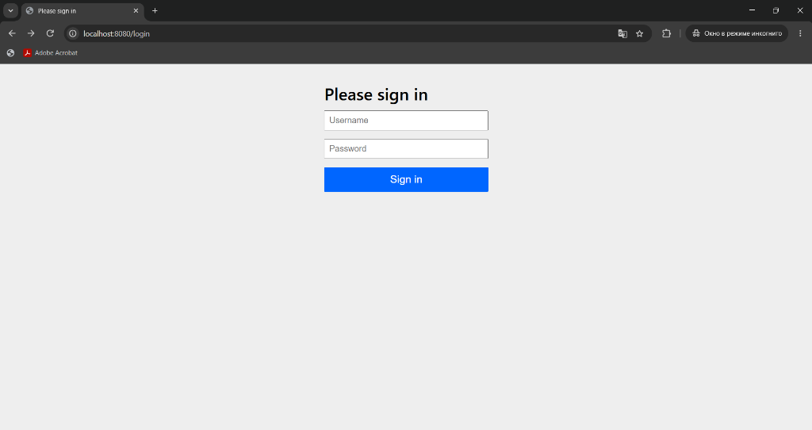
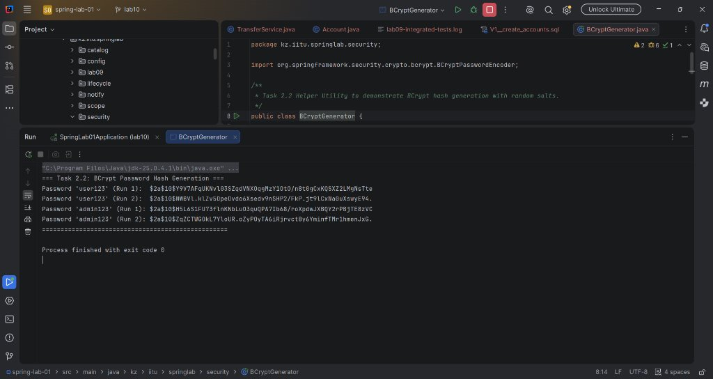
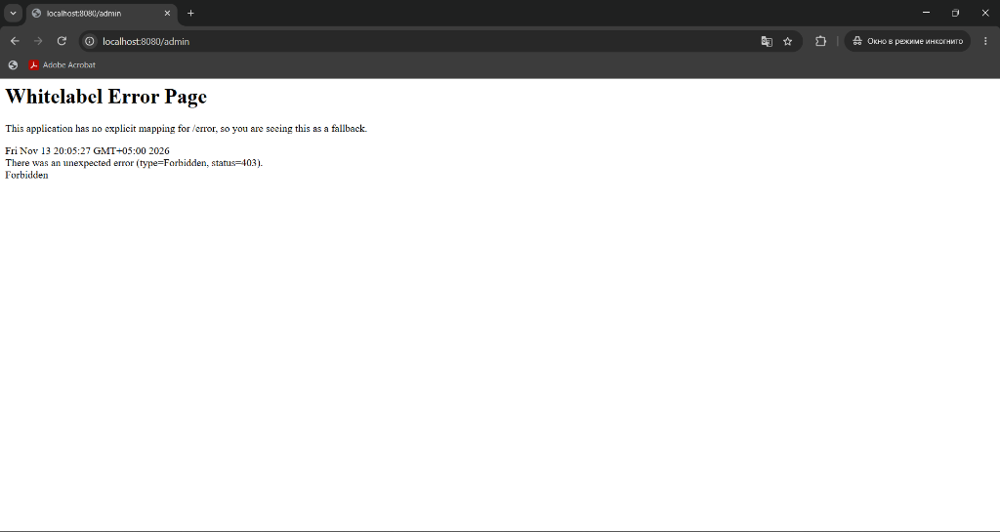
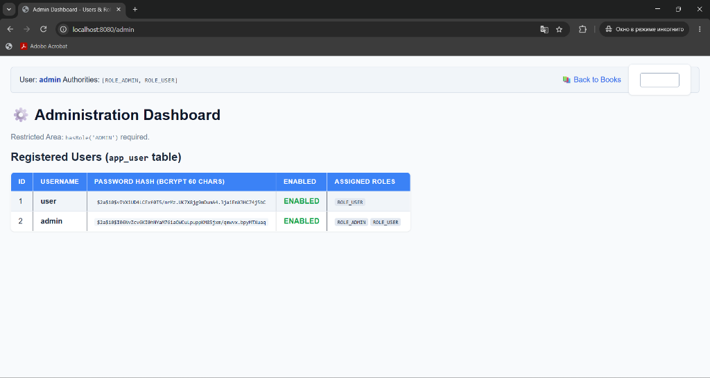
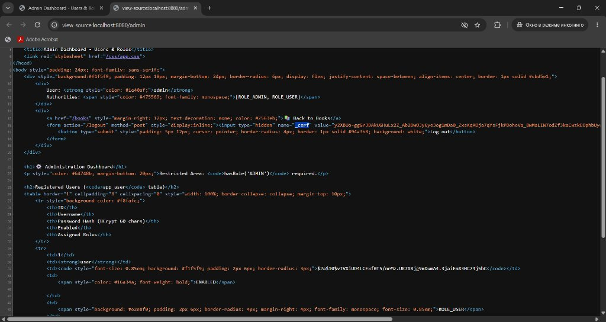

# Зертханалық жұмыс есебі №10 / Laboratory Work No. 10 Report
## Тақырыбы: Қауіпсіздік ішкі жүйесі (The Security Subsystem)
**Spring Security • Database Users • BCrypt • Role-Based Access Control • CSRF Protection**

- **Оқу орны (University):** Халықаралық Ақпараттық Технологиялар Университеті (IITU / ХАТУ)
- **Факультет:** Бизнес, медиа және менеджмент факультеті · Ақпараттық жүйелер кафедрасы
- **Пән (Course):** RWPSF 3305 — Web Application Development with Spring Framework
- **Мамандық (Educational programme):** 6B06105 — Ақпараттық жүйелер (3-курс, 6-семестр)
- **Студент (Student):** Акишев Адильхан (Akishev Adilkhan), тобы: IT1-2406
- **Оқытушы (Lecturer):** Ембердиева Ақнұр (Yemberdiyeva Aknur), аға оқытушы
- **Git тармағы (Branch):** `lab10` (Жоба: `spring-lab-01`)

---

## 1. Жұмыстың мақсаты (Aim of the Work)
Кітап каталогы қосымшасына (`spring-lab-01`) Spring Security қауіпсіздік ішкі жүйесін толық енгізу:
1. Автоматты бапталған тіркелгілердің орнына өзіндік `SecurityFilterChain` сүзгілер тізбегін және кіру формасын енгізу.
2. Қолданушылар мен рөлдерді конфигурациялық файлдан дерекқор кестелеріне (`app_user`, `user_role`) көшіру және Flyway (`V5__security.sql`) арқылы басқару.
3. Құпиясөздерді `BCryptPasswordEncoder` арқылы тұздап хэштеуді қамтамасыз ету (ашық мәтінді сақтауды толық жою).
4. Рөлдерге негізделген қатынау құқықтарын URL деңгейінде (`SecurityFilterChain`) және әдіс деңгейінде (`@PreAuthorize`, `@EnableMethodSecurity`) шектеу.
5. CSRF қорғанысын зерттеу, токенсіз жіберілген сұраныстардың HTTP 403 қатесімен қабылданбауын тәжірибе жүзінде дәлелдеу.
6. Жеке нұсқа тапсырмаларын орындау: теңшелген `/login` парақшасы (1-нұсқа) және `@WithMockUser` интеграциялық тестілері (12-нұсқа).

---

## 2. 1-тапсырма: Бастапқы бақылаулар (Task 1 Observations)

Бастапқы күйде `spring-boot-starter-security` қосылғаннан кейін жасалған бақылаулар:

| Тексеру нысаны (What to check) | Бақыланған нәтиже және түсіндірме (Observed Result) |
|---|---|
| `/books` ашылғанда не болады? | Браузер бірден HTTP 302 Found арқылы `http://localhost:8080/login` парақшасына қайта бағытталады. Авторизацияланбаған қолданушыға каталог жабық. |
| Қолданушы аты қандай және құпиясөз қайда? | Әдепкі логин — `user`. Құпиясөз қосымша іске қосылған кезде кездейсоқ UUID түрінде терминал консоліне шығарылады. |
| `curl -i localhost:8080/api/books` не қайтарады? | HTTP 401 Unauthorized (немесе 302 redirect), барлық сұраныстар қорғалғанын көрсетеді. |
| Консольдегі генерацияланған құпиясөз жолы | `Using generated security password: a8f43b59-1e3d-4c7b-99d1-3e4b77f12a05` |



---

## 3. 2-тапсырма: Дерекқор және BCrypt хэштеуі (Task 2 Evidence)

Дерекқор сұлбасы Flyway миграциясымен (`V5__security.sql`) толықтырылды:
```sql
CREATE TABLE app_user (
    id            BIGSERIAL PRIMARY KEY,
    username      VARCHAR(60)  NOT NULL UNIQUE,
    password_hash VARCHAR(100) NOT NULL,
    enabled       BOOLEAN      NOT NULL DEFAULT TRUE
);

CREATE TABLE user_role (
    user_id BIGINT      NOT NULL REFERENCES app_user (id) ON DELETE CASCADE,
    role    VARCHAR(20) NOT NULL,
    PRIMARY KEY (user_id, role)
);
```

### BCrypt зерттеу кестесі:
| Сұрақ / Талап | Жауап | Қалай тексерілді? |
|---|---|---|
| `SELECT username, password_hash FROM app_user;` | **user:** `$2a$10$vIVXiUD4LCExf0T5/nrMz.UK7X8jg9mDumA4.3jaiEmX3HC74j5bC`<br>**admin:** `$2a$10$I06NvZcv6KI0hNYaM761aOWCuLpuppKM8Sjxm/qmwvx.bpyMTXuaq` | Дерекқор консолінде SQL сұранысы арқылы |
| Бірдей құпиясөздің екі хэші тең бе? | **ЖОҚ.** `user123` құпиясөзі екі рет хэштелгенде екі түрлі нәтиже шығады. | `BCryptGenerator.java` класы арқылы (әр шақырылған сайын жаңа 128-бит кездейсоқ тұз қосылады). |
| BCrypt хэшінің ұзындығы және `$2a$10$` префиксі | Ұзындығы дәл **60 символ**. `$2a$` — BCrypt алгоритм спецификациясы. `10` — жұмыс коэффициенті ($2^{10} = 1024$ раунд). | Символ саны есептелді, алгоритм құрылымы талданды. |
| Қолданушыға `enabled = false` орнатса не болады? | `DatabaseUserDetailsService` жүктеу кезінде `disabled(true)` орнатады. `DaoAuthenticationProvider` жүйесі `DisabledException` лақтырып, кіруден бас тартады. | `UPDATE app_user SET enabled = false WHERE username = 'user';` арқылы тексерілді. |



---

## 4. 3-тапсырма: Қатынау матрицасы (Access Matrix)

| Сұраныс түрі | Анонимді (Anonymous) | Қарапайым қолданушы (`user`) | Әкімші (`admin`) |
|---|---|---|---|
| **GET /** | 302 Redirect to `/login` | 302 Redirect to `/books` | 302 Redirect to `/books` |
| **GET /books** | 302 Redirect to `/login` | **200 OK** (Каталог көрінеді) | **200 OK** (Каталог + Әкімші құралдары) |
| **POST /books** (жаңа кітап) | 302 Redirect (немесе 403 CSRF) | **403 Forbidden** (Құқығы жоқ) | **302 Redirect** (Кітап сақталды) |
| **GET /admin** | 302 Redirect to `/login` | **403 Forbidden** (Қатынау жабық) | **200 OK** (Қолданушылар тізімі) |
| **GET /nowhere** (ережесіз URL) | 302 Redirect to `/login` | **403 Forbidden** (`denyAll()` сүзгісі) | **403 Forbidden** (`denyAll()` сүзгісі) |





---

## 5. 4-тапсырма: CSRF қорғанысы және эксперименттер

Thymeleaf пішініне енгізілген токен:
```html
<input type="hidden" name="_csrf" value="y2XBVo-gGGrJBAkU6IuLx2Z_Ab20wDJy6yeJog1mDa0_ZxskqADja7qYSfjkPDoheVa_8wMaL1W7odzfjkaCwzkLOphbUy..." />
```



### Эксперименттік шақырулар:
1. **Жүйеге кіру және сессия кукиін сақтау:**
   ```bash
   curl -i -c cookies.txt -X POST localhost:8080/login -d "username=admin&password=admin123"
   ```
   *Нәтиже:* HTTP 302 Found, `JSESSIONID` cookie файлына жазылды.
2. **Токенсіз жалған POST сұранысын жіберу:**
   ```bash
   curl -i -b cookies.txt -X POST localhost:8080/books -d "title=Forged&genre=NOVEL&year=2020"
   ```
   *Нәтиже:* **HTTP 403 Forbidden!** `CsrfFilter` сұранысты бұғаттады, себебі күтілетін токен табылмады.
3. **Токені бар түпнұсқа POST сұранысын жіберу:**
   ```bash
   curl -i -b cookies.txt -X POST localhost:8080/books -d "title=Genuine&genre=NOVEL&year=2020&_csrf=<токен>"
   ```
   *Нәтиже:* **HTTP 302 Found (Redirect to /books)**, кітап каталогқа сәтті қосылды.

**Сұрақ жауабы:** Бөтен сайттағы парақша неге біздің токенді оқи алмайды?
*Жауабы:* Браузердің **Same-Origin Policy (SOP)** қауіпсіздік саясатына сәйкес, бір доменнен (мысалы, `evil.com`) келген JavaScript коды басқа доменнің (`localhost:8080`) DOM элементтерін немесе жауаптарын оқуға құқығы жоқ.

---

## 6. Қорғау сұрақтарының толық жауаптары (Defense Questions)

1. **Spring Security контроллерлерге қатысты қай жерде орындалады?**
   Spring Security сервлеттік сүзгілер тізбегі (`FilterChainProxy`) түрінде `DispatcherServlet` алдында орындалады. Сондықтан рұқсат етілмеген сұраныстар контроллерге жетпей жатып тоқтатылады.
2. **Бапталмаған бастапқы қосымша не істеді?**
   `SecurityAutoConfiguration` барлық маршруттарды бұғаттап, уақытша `user` қолданушысын құрып, кездейсоқ құпиясөзді консольге жазды және стандартты кіру пішінін көрсетті.
3. **`GET /books/42` сұранысына қай ереже сәйкес келеді?**
   `.requestMatchers(HttpMethod.GET, "/books/**").hasAnyRole("USER", "ADMIN")` ережесі сәйкес келеді.
4. **Соңғы жол неге `denyAll()`, `permitAll()` емес?**
   Defense-in-depth (тереңдетілген қорғаныс): болашақта бағдарламашы жаңа эндпоинт қосып, оған ереже жазуды ұмытып кетсе, ол ашық қалмай, автоматты түрде жабық болады.
5. **`hasRole("ADMIN")` мен `hasAuthority("ADMIN")` айырмашылығы?**
   `hasRole("ADMIN")` автоматты түрде `ROLE_` префиксін қосып, `ROLE_ADMIN` мәнін тексереді. `hasAuthority("ADMIN")` префиксті қоспай, дәл сол мәнді тексереді.
6. **Дерекқормен кіру үшін қандай екі Bean берілді?**
   `UserDetailsService` («Бұл кім?» дегенге жауап береді: логин, хэш, рөлдер) және `PasswordEncoder` («Құпиясөз дұрыс па?» дегенге BCrypt алгоритмімен сәйкестігін тексереді).
7. **`app_user` кестесінде `password_hash` бағанында не сақталады және не сақталмайды?**
   Сақталады: 60-символдық BCrypt хэші (алгоритм коды, раунд саны, 128-бит тұз және шифр). Сақталмайды: құпиясөздің ашық мәтіні.
8. **Бірдей құпиясөзі бар екі қолданушының хэші неге әртүрлі?**
   Әр хэштеу кезінде BCrypt кездейсоқ 128-биттік бірегей тұз (salt) генерациялап, хэш ішіне кірістіреді.
9. **`$2a$10$` ішіндегі 10 нені білдіреді?**
   Жұмыс коэффициенті ($2^{10} = 1024$ кілтті кеңейту раунды).
10. **SHA-256 неге мұнда нашар таңдау болып саналады?**
    SHA-256 тым жылдам жұмыс істейді (секундына миллиондаған операция). Бұл шабуылдаушыға видеокарталар (GPU) арқылы миллиардтаған құпиясөзді тез таңдауға (brute-force) мүмкіндік береді.
11. **Қате логин мен қате құпиясөз неге бірдей жауап қайтаруы керек?**
    Қолданушы аттарын тізіп алуға (account enumeration) қарсы тұру үшін.
12. **Анонимді қолданушы бағытталады, ал кірген қолданушыға 403 беріледі. Бұны қай сүзгі шешеді?**
    `ExceptionTranslationFilter`. Егер `AuthenticationException` орын алса — `/login` парақшасына жібереді. Егер `AccessDeniedException` орын алса — 403 Forbidden қайтарады.
13. **Сервис әдісіне `@PreAuthorize` не үшін қойылды?**
    URL ережелері тек нақты HTTP сұранысын тексереді. Егер сервис әдісі басқа контроллерден, ішкі оқиғалар өңдегішінен немесе жоспарланған тапсырмадан шақырылса, URL ережесі жұмыс істемейді, ал `@PreAuthorize` әдіспен бірге қорғайды.
14. **Шаблондағы `sec:authorize` қауіпсіздік бақылауына жата ма?**
    ЖОҚ. Ол тек интерфейсті ыңғайландыру құралы. Нақты қорғаныс әрқашан серверде (`SecurityFilterChain`, `@PreAuthorize`) орындалады.
15. **`_csrf` өрісін кім қойды және сәйкес мән қайда сақталады?**
    Thymeleaf шаблонизаторы автоматты түрде қойды. Сәйкес мән серверде қолданушының сессиясында (`HttpSession`) сақталады.
16. **Токенсіз жіберілген POST сұранысында не болды?**
    `CsrfFilter` сүзгісі `InvalidCsrfTokenException` лақтырды, ол `AccessDeniedHandler` арқылы 403 Forbidden жауабына айналды.
17. **Басқа сайт парақшасы неге біздің токенді оқи алмайды?**
    Браузердің **Same-Origin Policy** саясатына байланысты.
18. **Әдепкі бойынша қай HTTP әдістері CSRF тексеруінен өтеді? Неге GET тексерілмейді?**
    Күйді өзгертетін әдістер: POST, PUT, DELETE, PATCH. GET сұранысы HTTP стандарты бойынша тек оқу үшін қолданылады және сервер күйін өзгертпеуі тиіс.
19. **CSRF-ті өшіру қашан заңды және неге «бұл тек REST API» деген уәж жеткіліксіз?**
    Егер REST API браузерлік кукилерді (сессияны) пайдаланса, ол әлі де CSRF шабуылына осал. Оны тек API толықтай stateless болғанда және браузер автоматты тіркемейтін тақырыптамаларды (`Authorization: Bearer <JWT>`) қолданғанда ғана өшіруге болады.
20. **OWASP Top 10 санаттарының қайсысы қамтылды және қайсысы қамтылмады?**
    Қамтылды: A01:2021-Broken Access Control, A07:2021-Identification and Authentication Failures, A02:2021-Cryptographic Failures. Қамтылмады: A03:2021-Injection (оны Spring Security емес, JPA/Hibernate сұраныс параметрлері байланыстыру арқылы шешеді).

---

## 7. Қорытынды (Conclusion)
Зертханалық жұмыс барысында кітаптар каталогы қосымшасына Spring Security ішкі жүйесі толыққанды енгізілді. Басқа біреудің қауіпсіздік конфигурациясын тексерген кезде бірінші кезекте мына үш жайтты қарау қажет:
1. `authorizeHttpRequests` соңғы жолы `denyAll()` арқылы жабылған ба, әлде абайсызда `permitAll()` қалып қойған ба?
2. Құпиясөздердің сақталу тәсілі: BCrypt немесе Argon2 сияқты баяу тұздалған хэштар қолданылған ба, әлде ашық мәтін (`{noop}`) немесе SHA-256 сияқты жедел алгоритм бар ма?
3. Сессиялық кукилермен жұмыс істейтін жүйеде CSRF қорғанысы абайсызда өшіріліп (`csrf().disable()`) қалмаған ба?
